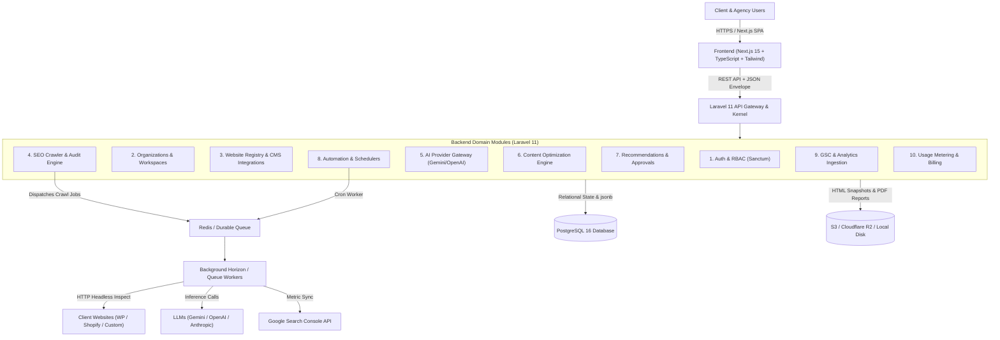

# SYSTEM ARCHITECTURE SPECIFICATION
**Project:** Web SEO AI  
**Version:** 1.0.0 (Phase 0 Baseline)  
**Architect:** Senior Software Architect & Full-Stack Engineer  

---

## 1. High-Level Architecture Overview

Web SEO AI is an enterprise-grade AI-powered SEO automation platform. The platform is designed around a decoupled, API-first architecture featuring an independent Laravel backend core and a Next.js frontend presentation layer.



---

## 2. Repository & Directory Structure

The project employs a clear two-tier separation between the API backend and the web frontend:

```text
web-seo-ai/
├── backend/                        # Laravel 11 API Application
│   ├── app/
│   │   ├── Domain/                 # Core Business Modules
│   │   │   ├── Auth/               # Authentication, Roles & Permissions
│   │   │   ├── Tenancy/            # Organizations, Workspaces & Memberships
│   │   │   ├── Websites/           # Registry, WordPress & Shopify Drivers
│   │   │   ├── Crawler/            # Asynchronous HTTP Crawler & DOM Parser
│   │   │   ├── Auditing/           # Rules Engine & Scoring Calculations
│   │   │   ├── AI/                 # LLM Provider Gateway (Gemini, OpenAI, Claude)
│   │   │   ├── Optimization/       # Meta, Schema & Content Generation
│   │   │   ├── Approvals/          # State Machine, Two-Phase Execution & Rollbacks
│   │   │   ├── Analytics/          # Google Search Console Ingestion & Rank Track
│   │   │   └── Metering/           # Audit Quotas, Token Metering & Subscriptions
│   │   ├── Http/
│   │   │   ├── Controllers/Api/V1/ # REST API Controllers
│   │   │   ├── Middleware/         # Tenant Scoping, Rate Limiting, Sanctum
│   │   │   ├── Requests/           # Form Request Validation Rules
│   │   │   └── Resources/          # API Resource Envelopes & Serialization
│   │   ├── Jobs/                   # Queued Background Jobs
│   │   ├── Models/                 # Eloquent Models
│   │   └── Policies/               # Authorization Policies
│   ├── config/                     # Configuration files (seo, ai, crawler, etc.)
│   ├── database/
│   │   ├── migrations/             # Idempotent DB Migrations
│   │   └── seeders/                # Initial Workspaces & Roles
│   ├── tests/
│   │   ├── Feature/                # Endpoint & Integration Tests
│   │   └── Unit/                   # Domain Logic & Audit Rule Tests
│   └── composer.json
│
├── frontend/                       # Next.js 15 App Router Application
│   ├── src/
│   │   ├── app/                    # App Router Pages & Layouts
│   │   │   ├── (auth)/             # Login, Register, Password Reset
│   │   │   ├── (dashboard)/        # Main Portal
│   │   │   │   ├── workspaces/     # Workspace Selection & Switcher
│   │   │   │   ├── websites/       # Website Registry & Health Overview
│   │   │   │   ├── audits/         # Technical Audit Deep-Dives
│   │   │   │   ├── approvals/      # Human-in-the-Loop Change Review Board
│   │   │   │   ├── content/        # AI Content & Meta Tag Generator
│   │   │   │   ├── analytics/      # GSC Insights & Keyword Tracking
│   │   │   │   └── settings/       # Integrations, API Keys, Team
│   │   │   ├── api/                # Next.js BFF (Backend for Frontend) proxy if needed
│   │   │   ├── layout.tsx
│   │   │   └── page.tsx
│   │   ├── components/             # Reusable UI Component Library
│   │   │   ├── common/             # Buttons, Modals, Badges, Tables, Cards
│   │   │   ├── audit/              # Score Gauges, Issue Cards, DOM Inspector
│   │   │   ├── approvals/          # Diff Viewer, Review Modal, Execution Button
│   │   │   └── analytics/          # Trend Charts, Keyword Tables
│   │   ├── hooks/                  # Custom React Hooks (useAuth, useAudit, useApproval)
│   │   ├── lib/                    # API Client, Fetch Wrapper, Token Management
│   │   └── types/                  # TypeScript Data Contracts
│   ├── public/                     # Static Assets
│   ├── tailwind.config.ts          # Styling System & Color Tokens
│   └── package.json
│
├── docs/                           # Architectural & API Documentation
├── .env.example                    # Global / Backend Environment Reference
├── ARCHITECTURE.md                 # System Architecture (This file)
├── DATABASE_DESIGN.md              # Database Schema & ERD
├── IMPLEMENTATION_ROADMAP.md       # Phased Execution Plan
├── PROJECT_AUDIT.md                # Environment & Tech Stack Audit
└── SECURITY_REQUIREMENTS.md        # Threat Matrix & Security Controls
```

---

## 3. Core Domain Modules & Boundaries

### Module 1: Authentication & Authorization (Auth)
- **Engine:** Laravel Sanctum.
- **RBAC Matrix:**
  - `Super Admin`: Platform-wide governance (Techboloy leadership).
  - `Org Admin`: Organization billing, workspace creation, member invites.
  - `SEO Lead / Manager`: Full audit control, AI prompt customization, approval sign-off.
  - `SEO Specialist`: Run audits, trigger AI generation, propose recommendations.
  - `Client Viewer`: Read-only access to specific client workspace reports and dashboards.

### Module 2: Organizations & Workspaces (Tenancy)
- Multi-tenancy achieved through strict tenant-scoping filters (`organization_id` & `workspace_id` on all domain entities).
- Internal vs External mode: Techboloy manages multiple client workspaces within its agency organization; future public SaaS users create their own isolated organization.

### Module 3: Website Registry & CMS Integrations
- Registry tracks target domain, CMS type (`wordpress`, `shopify`, `custom_html`, `spa`), sitemap URL, verification status, and health status.
- Integration Drivers:
  - `WordPressDriver`: Interacts with WP REST API `/wp-json/wp/v2/posts`, `/pages`, and SEO plugins (Yoast, RankMath) via encrypted Application Passwords.
  - `ShopifyDriver`: Communicates with Shopify Admin GraphQL API using OAuth access tokens.
  - `CustomWebDriver`: Passive read-only audit mode; generates structured developer instructions / code snippets (JSON-LD, meta tags, redirect rules).

### Module 4: SEO Crawling & Audit Engine
- Asynchronous crawl coordinator dispatched to background queue.
- Features:
  - Robots.txt parser and sitemap crawler (`sitemap.xml`).
  - Headless HTTP client with user-agent identification (`WebSeoAi-Bot/1.0 (+https://techboloy.com/bot)`).
  - Configurable rate limits (e.g., maximum 2 concurrent requests per domain).
  - SSRF guards blocking private, local, and loopback IPs.
  - Rule Categories:
    1. **Technical SEO:** HTTP status codes, canonical tags, redirect chains, robots meta, sitemap presence, XML errors.
    2. **On-Page SEO:** Title length/format, meta description, H1-H6 hierarchy, image alt attributes, word count, open graph tags.
    3. **Performance & Core Web Vitals:** Asset weight, script bottlenecks, render-blocking resources.
    4. **Link Health:** Internal broken links, external broken links, orphan pages.
    5. **Structured Data:** Schema.org JSON-LD validity, missing breadcrumbs, Organization schema.

### Module 5: AI Provider Abstraction
- Unified `AiManager` supporting multi-driver runtime resolution:
  - `GeminiDriver`: Google Gemini 1.5/2.0 Flash & Pro via REST API.
  - `OpenAiDriver`: OpenAI GPT-4o / GPT-4o-mini via REST API.
  - `ClaudeDriver`: Anthropic Claude 3.5 Sonnet.
- Features:
  - System prompt template engine with variable binding (`page_title`, `current_meta`, `target_keywords`, `competitor_context`).
  - Token counting, rate limit backoff, cost attribution per workspace.
  - Strict JSON schema enforcement (`json_schema` mode) to guarantee deterministic recommendation objects.

### Module 6: Content Optimization Engine
- Generates high-impact SEO deliverables:
  - Optimized Title Tags (40-60 characters, target keyword prioritized).
  - Meta Descriptions (140-160 characters, click-driving copy, CTA).
  - Rich JSON-LD Schema (Article, LocalBusiness, Product, FAQPage, BreadcrumbList).
  - Content outlines and content gap recommendations comparing target page against top ranking SERP content.

### Module 7: Recommendations & Approval Workflow
- **Golden Rule:** ZERO unverified or automatic live site write operations.
- State Machine:
  ```text
  [Identified Issue] 
         │
         ▼
  [AI Recommendation Generated] (Status: PENDING_REVIEW)
         │
         ├──> User Rejects / Edits
         │
         ▼
  [User Approved] (Status: APPROVED)
         │
         ▼
  [Execution Dispatcher] (Status: EXECUTING)
         │
         ├──> External CMS API Mutation (WP / Shopify)
         │
         ├──> Verification Crawl (Confirm live page updated)
         │
         ▼
  [Verified] (Status: APPLIED) <──> [Rollback Snapshot Stored]
  ```
- Every recommendation records:
  - Target URL, CSS selector / field path.
  - Old value vs Proposed new value (visual diff).
  - Approval timestamp, user ID, execution log, and pre-execution snapshot for one-click rollback.

### Module 8: Automation Jobs & Schedulers
- Scheduled tasks via Laravel Scheduler (`schedule:run`) & Horizon:
  - Weekly / Monthly full technical crawl.
  - Daily Search Console performance metric synchronization.
  - Automated weekly agency executive summary generation.

### Module 9: Analytics & Search Console Ingestion
- Syncs with Google Search Console API.
- Stores historical clicks, impressions, CTR, and average position grouped by URL and query.
- Correlates applied SEO recommendations with ranking improvements over 14, 30, and 90-day windows.

### Module 10: Usage Metering & Future Billing
- Logs every metered action: `pages_crawled`, `audits_run`, `ai_tokens_consumed`, `recommendations_applied`.
- Quota enforcement per workspace to ensure sustainable usage before and during public SaaS monetization.

---

## 4. API Design Conventions & Protocols

All backend endpoints adhere to strict RESTful standards under `/api/v1/`:

### Standard Envelope Format

```json
{
  "success": true,
  "data": { ... },
  "meta": {
    "page": 1,
    "per_page": 25,
    "total": 120,
    "total_pages": 5
  },
  "timestamp": "2026-10-12T04:00:00Z"
}
```

### Standard Error Response

```json
{
  "success": false,
  "error": {
    "code": "VALIDATION_FAILED",
    "message": "The given data was invalid.",
    "details": {
      "target_url": ["The target URL must be a valid public HTTPS URL."]
    }
  },
  "timestamp": "2026-10-12T04:00:00Z"
}
```

### HTTP Status Codes
- `200 OK`: Successful synchronous retrieval or update.
- `201 Created`: Resource successfully created.
- `202 Accepted`: Asynchronous operation queued (e.g., audit initiated).
- `400 Bad Request`: Invalid parameters or state transition.
- `401 Unauthorized`: Missing or invalid authentication token.
- `403 Forbidden`: Insufficient role or cross-tenant access violation.
- `404 Not Found`: Target resource does not exist in active workspace.
- `422 Unprocessable Entity`: Validation failure.
- `429 Too Many Requests`: Rate limit exceeded.
- `500 Internal Server Error`: Unhandled server exception (logged with correlation ID).

---

## 5. Background Jobs & Worker Architecture

Because web crawling, DOM parsing, and LLM text generation are I/O and compute intensive, all long-running tasks are offloaded to dedicated background queues:

| Job Name | Queue Priority | Retry Policy | Timeout | Purpose |
| :--- | :--- | :--- | :--- | :--- |
| `InitiateCrawlJob` | `high` | 2 retries, exp backoff | 120s | Initializes domain crawl and fetches sitemap/robots |
| `AnalyzePageJob` | `default` | 3 retries, exp backoff | 60s | Fetches single page DOM, runs audit rule evaluators |
| `GenerateAiRecommendationJob` | `default` | 2 retries, 10s backoff | 90s | Invokes LLM API with structured prompt |
| `ApplyRecommendationJob` | `high` | 1 retry (manual retry) | 45s | Pushes approved changes to WordPress/Shopify CMS |
| `SyncSearchConsoleDataJob` | `low` | 3 retries, 60s backoff | 300s | Daily fetch of GSC ranking and query performance |

---

## 6. Error Handling, Logging & Observability

- **Structured Logging:** All backend logs emit structured JSON with context: `workspace_id`, `user_id`, `action`, `trace_id`.
- **Exception Boundary:** All uncaught exceptions are caught by Laravel's global exception handler, masked from public display, and recorded with a unique `error_reference_id` returned to the user for support debugging.
- **Audit Trails:** All state-changing operations (user role changes, recommendation approvals, CMS pushes, integration credential changes) are recorded in an immutable `audit_logs` table.

---

## 7. Storage Strategy

- **Raw HTML Snapshots:** Compressed (`gzip`) and saved to object storage (`storage/app/snapshots/{audit_id}/{page_id}.html.gz` or S3 bucket) rather than PostgreSQL text columns to maintain database performance and prevent table bloat.
- **Reports:** Generated PDF and CSV audit exports stored with expiring signed download URLs.
- **Relational Data:** Structured findings, scores, and issue counters indexed in PostgreSQL.
