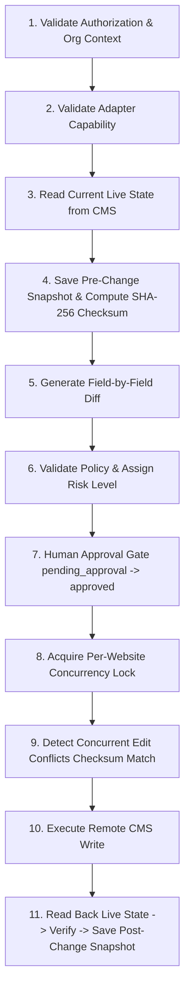

# PHASE 5 — CMS Integrations and Safe SEO Execution

## Executive Summary

Phase 5 introduces a secure, adapter-based integration and safe execution layer for **WordPress**, **Shopify**, and **Generic Custom Websites** within **Web SEO AI**. It enforces an ironclad 11-step execution pipeline, preventing accidental overwrites, unverified API submissions, and unauthorized remote modifications through human-in-the-loop approvals, checksum conflict detection, per-website concurrency locks, and pre/post-change snapshot rollbacks.

---

## 1. Common Integration Contract (`CmsAdapterInterface`)

Located in [`app/Domain/Integrations/Contracts/CmsAdapterInterface.php`](file:///Users/Alamin/Desktop/web-seo-ai/backend/app/Domain/Integrations/Contracts/CmsAdapterInterface.php).

All CMS adapters implement a standardized contract:
- `connect(array $credentials): array` — Verifies credentials and initializes remote connection.
- `verifyConnection(): bool` — Validates reachable remote API endpoint.
- `getCapabilities(): array` — Returns explicit list of supported capabilities.
- `supports(string $capability): bool` — Checks whether an operation is supported.
- `fetchPage(string $identifier): array` — Retrieves normalized state of a post/page/product.
- `updateSupportedMetadata(string $identifier, array $metadata): array` — Updates SEO title, meta description, and canonical URL.
- `updateContent(string $identifier, array $content): array` — Updates page body content or title.
- `createBackupOrSnapshot(string $identifier): array` — Captures structured backup payload.
- `verifyChange(string $identifier, array $expectedState): array` — Reads live state from remote CMS and returns verified status with matches and mismatches.
- `disconnect(): bool` — Revokes stored credentials.
- `getProviderName(): string` — Returns unique provider ID.

Any attempt to invoke an unsupported operation throws [`UnsupportedCapabilityException`](file:///Users/Alamin/Desktop/web-seo-ai/backend/app/Domain/Integrations/Exceptions/UnsupportedCapabilityException.php) with an explicit explanation rather than pretending to succeed.

---

## 2. Platform Adapters

### A. WordPress REST API Adapter (`WordPressAdapter`)
- **Transport**: Official WordPress REST API (`/wp-json/wp/v2/pages`, `/wp-json/wp/v2/posts`).
- **Authentication**: Application Passwords (HTTP Basic Auth) or Bearer Tokens stored with AES-256 encryption.
- **SEO Plugin Support**: Tested adapters for **Yoast SEO** (`_yoast_wpseo_title`, `_yoast_wpseo_metadesc`, `yoast_head_json`), **Rank Math** (`rank_math_title`, `rank_math_description`), and Core WordPress fallback.
- **Verification**: Post-execution live read-back to verify that custom fields were saved by WordPress and not dropped by third-party filters.

### B. Shopify Admin API Adapter (`ShopifyAdapter`)
- **Transport**: Shopify Admin REST API (`2025-01`).
- **Authentication**: OAuth offline tokens (`X-Shopify-Access-Token`) with minimum scopes (`read_content`, `write_content`, `read_products`, `write_products`).
- **SEO Fields**: Maps title and description tags (`metafield_title`, `metafield_description` in the `global` namespace).
- **Throttling & Backoff**: Automatically handles HTTP 429 rate limits (leaky bucket) with exponential backoff and `Retry-After` header parsing.

### C. Generic Custom Websites (`GenericCustomAdapter`)
- **Security Constraint**: Strictly **READ-ONLY** by default.
- Rejects any remote write or code execution with `UnsupportedCapabilityException`.
- Supports read-only audits and external snapshot generation.

---

## 3. Strict 11-Step Change Execution Pipeline

Located in [`app/Domain/Integrations/CmsExecutionPipeline.php`](file:///Users/Alamin/Desktop/web-seo-ai/backend/app/Domain/Integrations/CmsExecutionPipeline.php).

Every write follows this strict lifecycle:



### Distinction: Verified Live State vs Submitted API Request
An HTTP `200 OK` from an API write indicates that the request was accepted; it does **not** prove that the database persisted the exact fields (e.g. plugins intercepting or sanitizing). The pipeline executes a subsequent `fetchPage()` call and compares live fields against expected values:
- If all fields match $\rightarrow$ status becomes `verified` and `post_change_snapshot` is saved.
- If fields mismatch $\rightarrow$ status becomes `failed` with `ChangeVerificationFailedException`, recording detailed mismatches for immediate audit.

### Concurrency & Conflict Detection
Before writing to the CMS, the pipeline re-reads the page and computes a fresh SHA-256 checksum of its normalized state. If a human editor modified the page after the initial snapshot was taken, the checksums differ:
$\rightarrow$ Execution is instantly aborted with `ConflictDetectedException`, safeguarding human work from being overwritten.

---

## 4. Operational Safeguards & Rollback

- **Idempotency Keys**: Unique keys per request prevent duplicate submissions under network retries.
- **Per-Website Locks**: Managed via atomic cache locks (`Cache::lock`) to prevent race conditions during concurrent bulk edits.
- **Automated / One-Click Rollback**: When verification fails or when an agency user clicks *Rollback*, `rollbackToSnapshot()` restores the exact `state_payload` from the pre-change snapshot and verifies restoration on the live site.
- **Audit Logging**: Every staging, approval, execution, failure, and rollback is logged in `audit_logs` with actor details and payload snapshots.

---

## 5. Verification & Acceptance Testing

The test suite in [`backend/tests/Feature/CmsIntegrationAndExecutionTest.php`](file:///Users/Alamin/Desktop/web-seo-ai/backend/tests/Feature/CmsIntegrationAndExecutionTest.php) covers:
- Read-only contract enforcement on custom websites.
- WordPress adapter Yoast meta updates and live verification.
- Shopify Admin API `2025-01` rate limiting (HTTP 429) backoff and metafield mapping.
- Full 11-step execution pipeline (Staging $\rightarrow$ Approval $\rightarrow$ Lock $\rightarrow$ Execution $\rightarrow$ Verification).
- Conflict detection aborting writes when remote pages are modified externally.
- Detection of unverified writes where API returns 200 but values were dropped.
- Safe snapshot restoration and rollback.

**Test Results**:
```
PASS  Tests\Feature\CmsIntegrationAndExecutionTest
✓ generic custom adapter strictly enforces read only contract
✓ wordpress adapter capabilities and yoast metadata updates
✓ shopify adapter rate limit retry and seo metafields
✓ full 11 step execution pipeline staging approval and verification
✓ conflict detection prevents overwriting human edits
✓ verification failure distinguishes submitted request from live verification
✓ safe rollback restores pre change snapshot

Tests: 43 passed (278 assertions across suite)
```
