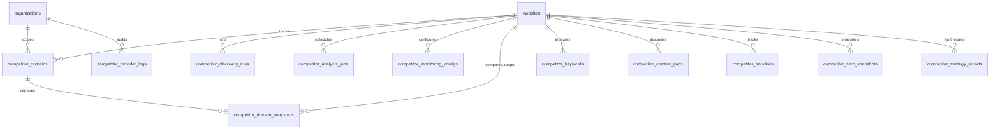

# Web SEO AI — Competitor Analysis Database Design

## 1. Design Principles

- **Database Compatibility:** Fully compatible with both **PostgreSQL (Neon Serverless in production)** and **SQLite (local development & PHPUnit tests)** via Laravel schema migrations.
- **Strict Multi-Tenancy:** Every table includes `organization_id` (FK → `organizations.id`, cascade delete) and `website_id` (FK → `websites.id`, cascade delete) plus composite indexes for fast tenant-scoped queries.
- **Provenance & Timestamps:** Every analytical dataset stores `data_source` (e.g., `dataforseo`, `semrush`, `ahrefs`, `serpapi`, `first_party_gsc`, `first_party_crawl`), `data_classification` (`first_party_verified`, `third_party_estimate`, `calculated`, `ai_insight`), and `fetched_at` / `captured_at` timestamps.
- **Nullable Metrics (No Fabrication):** Provider-dependent numeric fields (`organic_traffic_estimate`, `search_volume`, `keyword_difficulty`, `referring_domains`, `domain_authority`, etc.) are explicitly `nullable` so unavailable metrics remain `NULL` rather than `0` or fake numbers.

---

## 2. Entity-Relationship Overview

---

## 3. Table Specifications

### 3.1 `competitor_domains`
Stores tracked competitor domains per website.
- `id` (PK)
- `organization_id` (FK → `organizations.id`)
- `website_id` (FK → `websites.id`)
- `domain` (string 255, normalized lowercase host without protocol/www)
- `display_name` (string 255, nullable)
- `category` (string 40: `direct`, `organic_search`, `content`, `indirect`; default `direct`)
- `tier` (string 20: `primary`, `secondary`; default `primary`)
- `country` (string 10, default `US`)
- `language` (string 10, default `en`)
- `discovery_source` (string 40: `manual`, `dataforseo`, `serpapi`, `semrush`, `first_party_serp`)
- `discovery_confidence` (unsignedTinyInteger, nullable, 0–100)
- `discovery_rationale` (text, nullable)
- `is_active` (boolean, default `true`)
- `last_analyzed_at` (timestamp, nullable)
- `timestamps`
- **Unique Index:** `(website_id, domain)`
- **Indexes:** `(organization_id, website_id, is_active)`, `(website_id, category)`

### 3.2 `competitor_discovery_runs`
Stores automated competitor discovery runs & candidate domains awaiting manual confirmation.
- `id` (PK)
- `organization_id`, `website_id`, `initiated_by` (FK → `users.id`, nullable)
- `country` (string 10), `language` (string 10), `search_engine` (string 30, default `google`)
- `industry_context` (string 255, nullable)
- `provider` (string 50)
- `methodology` (text)
- `status` (string 30: `pending`, `running`, `completed`, `failed`)
- `candidates` (json — array of `{ domain, category, confidence, shared_keywords, serp_overlap_pct, relevance_reason, sample_urls, confirmed }`)
- `error_message` (text, nullable)
- `completed_at` (timestamp, nullable)
- `timestamps`

### 3.3 `competitor_domain_snapshots`
Stores historical point-in-time domain intelligence snapshots for BOTH the target website (`is_target = true`, `competitor_domain_id = null`) and each tracked competitor (`competitor_domain_id` set).
- `id` (PK)
- `organization_id`, `website_id`
- `competitor_domain_id` (FK → `competitor_domains.id`, nullable, cascade delete)
- `domain` (string 255)
- `is_target` (boolean, default `false`)
- `country` (string 10, default `US`), `language` (string 10, default `en`)
- `organic_traffic_estimate` (unsignedBigInteger, nullable)
- `organic_keywords_count` (unsignedInteger, nullable)
- `traffic_value_estimate` (decimal 12,2, nullable)
- `referring_domains_count` (unsignedInteger, nullable)
- `backlinks_count` (unsignedBigInteger, nullable)
- `indexed_pages_count` (unsignedInteger, nullable)
- `authority_score` (unsignedTinyInteger, nullable — 0–100)
- `authority_metric_label` (string 60, nullable — e.g. `DataForSEO Rank`, `Ahrefs DR`, `Semrush AS`)
- `serp_visibility_score` (decimal 6,2, nullable)
- `ranking_distribution` (json, nullable — `{ pos_1_3, pos_4_10, pos_11_20, pos_21_50, pos_51_100 }`)
- `top_keywords` (json, nullable)
- `top_pages` (json, nullable)
- `crawled_signals` (json, nullable — verified first-party HTML signals: title, H1, word count, schema types, page speed, internal links)
- `data_source` (string 50)
- `data_classification` (string 30: `first_party_verified`, `third_party_estimate`, `hybrid`)
- `captured_at` (timestamp)
- `timestamps`
- **Indexes:** `(website_id, domain, captured_at)`, `(competitor_domain_id, captured_at)`

### 3.4 `competitor_keywords`
Stores normalized keyword intelligence & multi-domain ranking positions for Keyword Gap Analysis.
- `id` (PK)
- `organization_id`, `website_id`
- `keyword` (string 255)
- `country` (string 10, default `US`), `language` (string 10, default `en`)
- `search_volume` (unsignedInteger, nullable)
- `keyword_difficulty` (unsignedTinyInteger, nullable — 0–100)
- `cpc` (decimal 8,2, nullable)
- `search_intent` (string 30, nullable: `informational`, `commercial`, `transactional`, `navigational`)
- `target_position` (unsignedSmallInteger, nullable)
- `target_url` (string 1024, nullable)
- `competitor_positions` (json — map of `{ "comp.com": { position, url, traffic_share } }`)
- `gap_type` (string 30: `missing`, `weak`, `shared`, `strong`, `untapped`)
- `serp_features` (json, nullable — e.g. `["featured_snippet", "people_also_ask", "local_pack"]`)
- `opportunity_score` (decimal 5,2, nullable)
- `data_source` (string 50)
- `data_classification` (string 30)
- `last_updated_at` (timestamp)
- `saved_recommendation_id` (unsignedBigInteger, nullable)
- `timestamps`
- **Unique Index:** `(website_id, keyword, country, language)`
- **Indexes:** `(website_id, gap_type)`, `(website_id, search_intent)`, `(website_id, search_volume)`

### 3.5 `competitor_content_gaps`
Stores evidence-backed topic and content gap opportunities.
- `id` (PK)
- `organization_id`, `website_id`
- `topic` (string 255)
- `suggested_title` (string 255)
- `primary_keyword` (string 255)
- `secondary_keywords` (json, nullable)
- `search_intent` (string 30, default `informational`)
- `suggested_content_type` (string 60: `guide`, `comparison`, `landing_page`, `checklist`, `case_study`, `blog_post`)
- `recommended_outline` (json, nullable)
- `competitor_reference_urls` (json — `[{ domain, url, title, estimated_traffic }]`)
- `target_coverage_status` (string 40: `missing_verified`, `weak_coverage`, `unverified_crawl_needed`)
- `rationale` (text)
- `priority` (string 20: `critical`, `high`, `medium`, `low`)
- `confidence` (string 20: `high`, `medium`, `low`)
- `data_source` (string 50)
- `status` (string 30: `open`, `sent_to_studio`, `saved_to_action_plan`, `dismissed`)
- `content_brief_id` (unsignedBigInteger, nullable)
- `timestamps`
- **Indexes:** `(website_id, priority, status)`

### 3.6 `competitor_backlinks`
Stores provider-backed referring domains and backlink rows for Backlink Gap Analysis.
- `id` (PK)
- `organization_id`, `website_id`
- `competitor_domain_id` (FK → `competitor_domains.id`, nullable, cascade delete)
- `target_domain` (string 255 — which domain receives the link)
- `is_target_site` (boolean, default `false`)
- `referring_domain` (string 255)
- `referring_url` (string 1024, nullable)
- `destination_url` (string 1024, nullable)
- `anchor_text` (string 512, nullable)
- `link_type` (string 30: `dofollow`, `nofollow`, `ugc`, `sponsored`, `unknown`)
- `referring_authority` (unsignedTinyInteger, nullable)
- `link_status` (string 20: `active`, `new`, `lost`)
- `first_seen_at` (timestamp, nullable)
- `last_seen_at` (timestamp, nullable)
- `data_source` (string 50)
- `timestamps`
- **Indexes:** `(website_id, referring_domain)`, `(website_id, is_target_site)`, `(website_id, link_type)`

### 3.7 `competitor_serp_snapshots`
Stores SERP analysis snapshots and monitored keyword tracking state.
- `id` (PK)
- `organization_id`, `website_id`
- `keyword` (string 255)
- `country` (string 10, default `US`), `language` (string 10, default `en`)
- `search_engine` (string 30, default `google`)
- `device` (string 20, default `desktop`)
- `location` (string 120, nullable)
- `is_monitored` (boolean, default `false`)
- `search_intent` (string 30, nullable)
- `serp_features` (json, nullable)
- `organic_results` (json — array of `{ position, domain, url, title, snippet, is_target, is_competitor, competitor_category }`)
- `target_position` (unsignedSmallInteger, nullable)
- `competitor_presence` (json, nullable — `{ "comp.com": 2 }`)
- `content_patterns` (json, nullable)
- `data_source` (string 50)
- `captured_at` (timestamp)
- `timestamps`
- **Indexes:** `(website_id, keyword, country, device, captured_at)`, `(website_id, is_monitored)`

### 3.8 `competitor_strategy_reports`
Stores AI Competitor Strategist reports with structured evidence-grounded sections.
- `id` (PK)
- `organization_id`, `website_id`, `generated_by` (FK → `users.id`, nullable)
- `analysis_job_id` (unsignedBigInteger, nullable)
- `competitor_ids` (json)
- `executive_summary` (text)
- `strength_analysis` (json)
- `weakness_analysis` (json)
- `keyword_opportunities` (json)
- `content_opportunities` (json)
- `backlink_opportunities` (json)
- `serp_opportunities` (json)
- `strategic_recommendations` (json — array with `title`, `explanation`, `supporting_evidence`, `source_url`, `expected_benefit`, `priority`, `effort`, `confidence`, `next_action`, `observed_vs_interpreted`)
- `provider_model` (string 80)
- `data_sources_used` (json)
- `generated_at` (timestamp)
- `timestamps`

### 3.9 `competitor_monitoring_configs`
Stores per-website scheduled monitoring configuration & change alert log.
- `id` (PK)
- `organization_id`, `website_id` (unique per website)
- `frequency` (string 20: `daily`, `weekly`, `monthly`, `manual`; default `weekly`)
- `country` (string 10, default `US`), `language` (string 10, default `en`)
- `notify_on_rank_change` (boolean, default `true`)
- `notify_on_new_keywords` (boolean, default `true`)
- `notify_on_backlink_change` (boolean, default `true`)
- `min_position_delta` (unsignedTinyInteger, default `3`)
- `last_run_at` (timestamp, nullable)
- `next_run_at` (timestamp, nullable)
- `recent_alerts` (json, nullable — meaningful detected changes only)
- `timestamps`

### 3.10 `competitor_analysis_jobs`
Tracks queued/background competitor analysis runs with step progress, retries, and error logs.
- `id` (PK)
- `organization_id`, `website_id`, `initiated_by` (FK → `users.id`, nullable)
- `job_type` (string 40: `full_analysis`, `discovery`, `domain_refresh`, `keyword_gap`, `content_gap`, `backlink_gap`, `serp_check`, `ai_strategy`)
- `status` (string 30: `queued`, `running`, `completed`, `failed`)
- `progress_percent` (unsignedTinyInteger, default `0`)
- `competitor_ids` (json, nullable)
- `parameters` (json, nullable)
- `result_summary` (json, nullable)
- `error_message` (text, nullable)
- `started_at` (timestamp, nullable), `completed_at` (timestamp, nullable)
- `timestamps`

### 3.11 `competitor_provider_logs`
Tracks external SEO API usage, latency, cache hits, estimated unit cost, and failures per organization.
- `id` (PK)
- `organization_id`, `website_id` (nullable)
- `provider` (string 50)
- `capability` (string 40: `discovery`, `domain_metrics`, `keywords`, `backlinks`, `serp`, `first_party_crawl`)
- `endpoint` (string 255)
- `status` (string 20: `success`, `cached`, `failed`, `unconfigured`)
- `http_status` (unsignedSmallInteger, nullable)
- `duration_ms` (unsignedInteger, default `0`)
- `estimated_cost_usd` (decimal 10,6, default `0`)
- `error_message` (text, nullable)
- `created_at` (timestamp)
- **Indexes:** `(organization_id, provider, created_at)`
