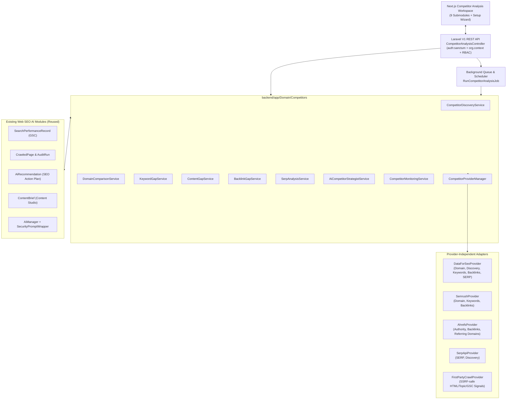

# Web SEO AI — Competitor Analysis Module Architecture

## 1. Existing System Audit Summary

An audit of the Web SEO AI repository (`/Users/Alamin/Desktop/web-seo-ai`) confirms the following production architecture:

- **Backend:** Laravel 11 (PHP 8.4), served locally via Artisan/FrankenPHP and in production on Vercel Services (`backend/Dockerfile.vercel`) with Neon Serverless PostgreSQL (`pgsql`) and SQLite fallback for tests.
- **Authentication & Multi-Tenancy:** Laravel Sanctum Bearer tokens (`auth:sanctum`), strict organization scoping via `EnsureOrganizationContext` (`org.context`, `X-Organization-Id` header), and hierarchical RBAC via `RequireOrganizationRole` (`org.role:owner|admin|seo_manager|editor|viewer`).
- **Frontend:** Next.js 16.4.6 (App Router, Turbopack, React 19, TypeScript) with Tailwind CSS v4 (dark-first design system with Light/System/Dark theme tokens in `frontend/src/app/globals.css`), `AuthContext`, `ToastContext`, `ThemeContext`, and typed API client `frontend/src/lib/api.ts`.
- **Reusable First-Party Services & Models:**
  - `Website`, `Organization`, `WebsiteContextProfile`, `AuditLog`
  - `CrawlJob`, `CrawledPage`, `AuditRun`, `AuditIssue`, `PageInspector`, `UrlSecurityValidator`, `UrlNormalizer`
  - `SearchPerformanceRecord`, `SearchOpportunity`, `GoogleSearchConsoleService` (verified first-party GSC queries, pages, clicks, impressions, positions)
  - `AiRecommendation` (SEO Action Plan target for saving competitor opportunities)
  - `ContentBrief` (Content Studio target for sending approved content gap opportunities)
  - `AiManager` (`gemini` / `openai` / `deterministic_studio`) + `SecurityPromptWrapper` (prompt-injection & secret scrubbing)
- **Current Third-Party SEO Provider Audit:**
  - `config/keywords.php` contains environment placeholders for `DATAFORSEO_LOGIN`, `DATAFORSEO_PASSWORD`, and `DATAFORSEO_BASE_URL`, with only `SandboxKeywordDriver` currently wired.
  - No live third-party SEO API keys (`DATAFORSEO_*`, `SEMRUSH_API_KEY`, `AHREFS_API_KEY`, `SERPAPI_KEY`) are currently configured in `backend/.env`.
  - Therefore, the Competitor Analysis Module MUST strictly enforce **zero fabricated third-party metrics** and clearly distinguish:
    1. `first_party_verified` — Verified First-Party Data (GSC + SSRF-safe live site/competitor HTML crawl)
    2. `third_party_estimate` — Third-Party Estimates (DataForSEO / Semrush / Ahrefs / SerpApi, attributed by provider & timestamp)
    3. `calculated` — Deterministic calculations derived strictly from retrieved records (e.g., keyword gap classification, overlap %, position delta)
    4. `ai_insight` — AI-generated strategic interpretations strictly grounded in observed evidence

---

## 2. High-Level Module Architecture

---

## 3. Domain Layer Structure (`backend/app/Domain/Competitors/`)

- `Contracts/`
  - `CompetitorDiscoveryProviderInterface.php`
  - `DomainMetricsProviderInterface.php`
  - `KeywordDataProviderInterface.php`
  - `BacklinkDataProviderInterface.php`
  - `SerpDataProviderInterface.php`
- `Providers/`
  - `DataForSeoProvider.php` — Unified DataForSEO v3 adapter (Labs Domain Overview, Ranked Keywords, Competitors Domain, Backlinks Summary & Referring Domains, SERP Google Organic Live).
  - `SemrushProvider.php` — Semrush Analytics API adapter (Domain Ranks, Domain Organic Keywords, Backlinks Overview).
  - `AhrefsProvider.php` — Ahrefs API v3 adapter (Domain Rating, Backlinks Stats, Referring Domains).
  - `SerpApiProvider.php` — SerpApi Google Organic Search adapter (SERP snapshots & organic competitor extraction).
  - `FirstPartyCrawlProvider.php` — Always-available SSRF-protected live crawl & GSC signal extractor for verified on-page content/topic/heading/schema analysis.
- `CompetitorProviderManager.php` — Resolves best configured provider per capability (`discovery`, `domain_metrics`, `keywords`, `backlinks`, `serp`), manages caching (`Cache::remember`), rate limiting, and writes `competitor_provider_logs` for every external API call.
- `Services/`
  - `CompetitorDiscoveryService.php` — Intelligent multi-signal discovery (provider overlap + SERP overlap + business context filtering so single-keyword portals/Wikipedia/social platforms are not misclassified as direct business competitors) with methodology & confidence score.
  - `DomainComparisonService.php` — Multi-domain side-by-side matrix (target website + up to 5 competitors), strengths/weaknesses, visibility scores, and strict provenance labels.
  - `KeywordGapService.php` — Classifies keywords into `missing`, `weak`, `shared`, `strong`, and `untapped` using real target rankings (GSC + provider) vs competitor rankings; supports filtering, sorting, CSV export, and saving directly to `AiRecommendation`.
  - `ContentGapService.php` — Cross-references competitor top-performing pages/topics against verified target `CrawledPage` & `SearchPerformanceRecord` records; generates grounded content opportunities and pushes approved briefs directly to `ContentBrief` (Content Studio).
  - `BacklinkGapService.php` — Computes referring domain gaps (linking to competitors but not target), shared referring domains, follow/nofollow breakdown, growth deltas, and CSV export.
  - `SerpAnalysisService.php` — Captures country/language/device-scoped SERP snapshots, identifies competitor presence, SERP features, intent patterns, and tracks historical rank deltas for monitored keywords.
  - `AiCompetitorStrategistService.php` — Feeds strictly retrieved competitor snapshots, gaps, and SERP records through `SecurityPromptWrapper` + `AiManager` (or deterministic evidence synthesizer when no external LLM key is configured) to generate categorized strategic reports (`strengths`, `weaknesses`, `keyword_opportunities`, `content_opportunities`, `backlink_opportunities`, `serp_opportunities`, `strategic_recommendations`, `action_plan`) with Critical/High/Medium/Low priorities and 1-click export to SEO Action Plan.
  - `CompetitorMonitoringService.php` — Manages Daily/Weekly/Monthly/Manual monitoring schedules, historical snapshots, delta detection (new/lost keywords, rank changes, backlink changes), and meaningful-change alerts.

---

## 4. Frontend Module Architecture (`frontend/src/components/competitors/`)

- **Primary Navigation Entry:** New item **`Competitor Analysis`** added to `Sidebar.tsx` (`activeTab === 'competitors'`), rendered by `CompetitorAnalysisView.tsx` in `frontend/src/app/page.tsx`.
- **9 Submodules (clean sub-navigation inside `CompetitorAnalysisView.tsx`):**
  1. `Overview` — Executive intelligence summary, guided 9-step beginner workflow strip, provider connection banner, top competitors, key gap highlights, and quick actions.
  2. `My Competitors` — Manual domain entry, intelligent auto-discovery with review & confirmation before adding, primary/secondary toggle, category selector (`direct`, `organic_search`, `content`, `indirect`), and remove/refresh controls.
  3. `Domain Comparison` — Side-by-side comparison of target website + up to 5 selected competitors with interactive SVG/bar comparison visuals, metric definitions, data provenance badges, and strength/weakness matrix.
  4. `Keyword Gap` — Missing / Weak / Shared / Strong / Untapped tabs, full filter bar (country, language, intent, min/max volume, max KD, competitor, position), sorting, CSV export, and 1-click "Save to SEO Action Plan".
  5. `Content Gap` — Competitor top pages & topic gaps grounded in crawled pages, recommended outlines, priority tags, and 1-click "Send to Content Studio".
  6. `Backlink Gap` — Referring domain gap & shared domains table, follow/nofollow split, filters, CSV export, and transparent provider status when backlink API is unconfigured.
  7. `SERP Analysis` — Keyword SERP analyzer (country, language, device), organic top results, SERP features badges, competitor highlighting, monitored keywords list, and historical snapshot diff.
  8. `AI Strategy` — Structured AI Competitor Strategist report (Strengths, Weaknesses, Keyword/Content/Backlink/SERP opportunities, Prioritized Action Plan) with observed-vs-interpreted separation and 1-click save to SEO Action Plan.
  9. `Competitor History` — Monitoring schedule manager (Daily/Weekly/Monthly/Manual), historical snapshot timeline, visibility/keyword/backlink trend charts, detected change alerts, and API Provider Configuration status drawer.

---

## 5. Non-Negotiable Safety & Compatibility Guarantees

- **Zero Breaking Changes:** Existing Site Audit, Crawler, Google Search Console, SEO Action Plan, Content Studio, CMS Execution, Autopilot, and Billing routes/tables remain untouched.
- **Strict Tenant Isolation:** Every new table carries `organization_id` and `website_id` with foreign keys and composite indexes; every controller endpoint enforces `auth:sanctum`, `org.context`, and website ownership checks.
- **No Fabricated Metrics:** Any metric unsupported by a connected provider is persisted as `null` and rendered in UI as `"Data unavailable"` with source attribution.
- **SSRF & Secret Protection:** All outbound domain/page fetches pass through `UrlSecurityValidator`; all provider keys live strictly in backend environment variables (never exposed to Next.js frontend).
