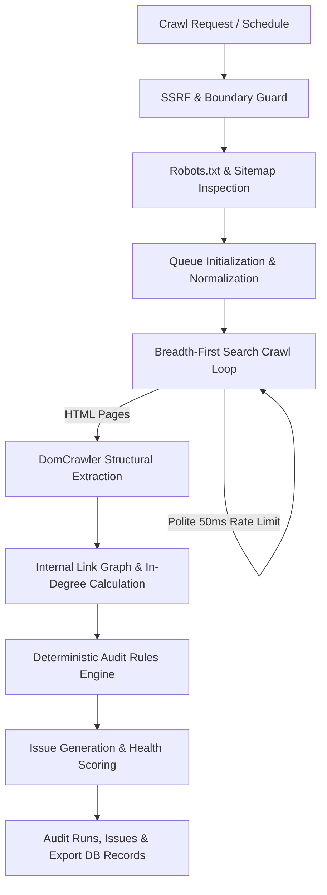

# Web SEO AI — Technical SEO Crawler & Audit Engine (Phase 2)

## 1. Architectural Overview & Execution Lifecycle

Web SEO AI Phase 2 implements a high-performance, asynchronous web crawler and deterministic technical SEO auditing engine built for agency-scale multi-tenant workspaces.



### Key Components

- **`UrlSecurityValidator`**: Untrusted URL validation engine blocking SSRF, loopback (`127.0.0.1`), RFC1918 private subnets, cloud metadata (`169.254.169.254`), and unauthorized target domains.
- **`UrlNormalizer`**: RFC 3986 deterministic URL normalizer resolving relative paths, removing fragments (`#`), stripping extraneous slashes, and sorting query parameters deterministically.
- **`RobotsTxtParser`**: Parses user-agent specific and wildcard directives (`Disallow`, `Allow`, `Sitemap`).
- **`SitemapParser`**: XXE-immune XML parser extracting `<loc>` tags from sitemap indexes and standard `<urlset>` feeds.
- **`PageInspector`**: Headless structural analyzer using Symfony DomCrawler for tags, headings hierarchy, image alt attributes, canonicals, and links.
- **`CrawlEngine`**: Asynchronous BFS crawl orchestrator maintaining in-degree topology counts and execution logs.
- **`AuditRulesEngine`**: Deterministic evaluator scoring websites across Technical, Content, and Links categories.

---

## 2. Crawl Limits & Configurable Constraints

| Parameter | Default | Range | Description |
| :--- | :--- | :--- | :--- |
| **Max Pages** | `50` | `5` – `500` | Hard ceiling on crawled pages per run to prevent resource exhaustion. |
| **Max Depth** | `3` | `1` – `5` | Maximum crawl tree depth from root (0 = home, 1 = direct children). |
| **Concurrency** | `2` | `1` – `4` | Worker threads/pools respecting polite delays. |
| **Rate Limiting** | `50ms` | Configurable | Polite sleep pause between page requests to avoid server degradation. |
| **Request Timeout** | `10s` | `5s` – `15s` | Max duration per HTTP GET attempt before timeout error. |
| **User Agent** | `WebSeoAi-Bot/1.0 (+https://techboloy.com/bot)` | Custom | Identifies crawler politely to site administrators. |
| **Parser Strategy** | Fast HTML DomCrawler | Default | Headless HTML parser for standard static/SSR sites; headless browser reserved for configured JS-heavy pages. |

---

## 3. SSRF & Crawler Security Controls

All input URLs and redirect destinations are treated as untrusted:

1. **Protocol Whitelist**: Only `http` and `https` schemes are accepted. Protocols like `file://`, `gopher://`, `dict://`, `ftp://`, or `php://` are rejected.
2. **Authorized Domain Boundaries**: The crawl engine strictly rejects any target host that does not match or belong as a subdomain of the verified website domain.
3. **DNS Re-Validation & Blacklisted IPs**: Target hostnames are resolved via DNS before every request. The IP is checked against:
   - Loopback (`127.0.0.0/8`, `::1`)
   - Zero address (`0.0.0.0/8`)
   - Link-local and Cloud Metadata endpoints (`169.254.0.0/16`, AWS/GCP/Azure metadata)
   - RFC 1918 Private ranges (`10.0.0.0/8`, `172.16.0.0/12`, `192.168.0.0/16`)
   - IPv6 private/unique-local ranges (`fe80::/10`, `fc00::/7`)
4. **XXE Protection**: XML parsers disable external entity resolution (`LIBXML_NONET`) preventing local file disclosure or SSRF via malicious sitemaps.

---

## 4. Deterministic SEO Rules Matrix

| Rule Type | Category | Severity | Detection Logic | Evidence Captured |
| :--- | :--- | :--- | :--- | :--- |
| `STATUS_4XX` | Technical | **Critical** | HTTP status code between 400 and 499 | `{"status_code": 404}` |
| `STATUS_5XX` | Technical | **Critical** | HTTP status code $\ge 500$ | `{"status_code": 500}` |
| `BROKEN_INTERNAL_LINK` | Links | **Critical** | Internal link pointing to an in-domain 4xx/5xx target | `{"target_url": "...", "status_code": 404}` |
| `MISSING_TITLE` | Content | **Critical** | `<title>` tag is absent or whitespace | `{"page_title": null}` |
| `TITLE_TOO_LONG` | Content | Notice | `<title>` exceeds 60 characters | `{"title_length": 74}` |
| `TITLE_TOO_SHORT` | Content | Notice | `<title>` is under 15 characters | `{"title_length": 8}` |
| `DUPLICATE_TITLE` | Content | Warning | Multiple distinct URLs share identical title text | `{"duplicate_count": 3, "conflicts": [...]}` |
| `MISSING_META_DESCRIPTION` | Content | Warning | Meta description tag absent or empty | `{"meta_description": null}` |
| `META_DESCRIPTION_TOO_LONG` | Content | Notice | Meta description exceeds 160 characters | `{"desc_length": 182}` |
| `META_DESCRIPTION_TOO_SHORT` | Content | Notice | Meta description is under 50 characters | `{"desc_length": 25}` |
| `DUPLICATE_META_DESCRIPTION` | Content | Warning | Multiple URLs share identical meta description | `{"duplicate_count": 2, "conflicts": [...]}` |
| `MISSING_H1` | Content | **Critical** | Page contains zero `<h1>` tags | `{"h1_count": 0}` |
| `MULTIPLE_H1` | Content | Warning | Page contains $> 1$ `<h1>` tags | `{"h1_tags": ["Title A", "Title B"]}` |
| `HEADING_HIERARCHY_JUMP` | Content | Notice | Heading levels skip hierarchy (e.g. H1 directly to H3) | `{"from": "h1", "to": "h3"}` |
| `MISSING_IMAGE_ALT` | Content | Warning | `` tags lack non-empty `alt` attribute | `{"missing_count": 4, "total_images": 6}` |
| `MISSING_CANONICAL` | Technical | Warning | Page lacks `<link rel="canonical">` | `{"canonical_url": null}` |
| `CANONICAL_MISMATCH` | Technical | Warning | Canonical tag points to a different URL | `{"current_url": "...", "canonical_url": "..."}` |
| `NOINDEX_PAGE` | Indexing | Notice | Page has `noindex` in meta robots or `X-Robots-Tag` | `{"meta_robots": "noindex, nofollow"}` |
| `ORPHAN_PAGE` | Links | Warning | Present in `sitemap.xml` but 0 inbound internal links | `{"in_degree": 0, "in_sitemap": true}` |
| `PAGE_NOT_IN_SITEMAP` | Indexing | Notice | Indexable discovered page missing from `sitemap.xml` | `{"in_sitemap": false}` |
| `ROBOTS_TXT_MISSING` | Technical | Warning | `/robots.txt` returned 404 or connection error | `{"robots_url": "https://domain.com/robots.txt"}` |

---

## 5. Issue Data Model & Verification Protocol

Every issue persisted in the `audit_issues` database table adheres strictly to the lifecycle model:

```json
{
  "id": 142,
  "audit_run_id": 12,
  "crawled_page_id": 84,
  "issue_type": "BROKEN_INTERNAL_LINK",
  "category": "links",
  "severity": "critical",
  "affected_url": "https://example.com/blog/article",
  "evidence": {
    "target_url": "https://example.com/old-page",
    "anchor_text": "Read Old Article",
    "status_code": 404
  },
  "explanation": "Page contains an internal hyperlink pointing to a target that returned an HTTP 404 client error.",
  "recommended_fix": "Update or remove the broken hyperlink to point to an active, relevant page.",
  "current_status": "open",
  "verification_status": "unverified",
  "first_seen_at": "2026-10-12T11:00:00Z",
  "last_seen_at": "2026-10-12T11:27:00Z"
}
```

### Verification Integrity Rule

> [!IMPORTANT]
> **No Premature Resolution Claims:** An issue is never marked as `resolved` or `verified_fixed` simply because an AI recommendation or fix patch was created. Fixes are verified only when a subsequent crawl confirms the issue is absent from live responses. If an issue reappears after being absent, it is flagged as `regression`.

---

## 6. Before / After Audit Comparison

The comparison endpoint (`GET /websites/{id}/audits/compare?run1={id}&run2={id}`) computes:
1. **Score Delta**: Overall health score improvement or decline ($\Delta = \text{Score}_2 - \text{Score}_1$).
2. **Resolved Issues List**: Issues present in baseline Run 1 that are completely absent in Run 2.
3. **New / Regressed Issues List**: Issues newly detected in Run 2 that did not exist in Run 1.

---

## 7. Automated Test Suite Matrix

Full verification has been achieved across unit, integration, and feature tests in `tests/Feature/CrawlerAndAuditTest.php`:

| Test Name | Coverage |
| :--- | :--- |
| `test_ssrf_validator_blocks_private_ips_and_metadata_endpoints` | Confirms blocks on `169.254.169.254` (cloud metadata). |
| `test_ssrf_validator_blocks_loopback_and_private_rfc1918_ranges` | Confirms blocks on `127.0.0.1`, `10.0.0.1`, `192.168.1.1`. |
| `test_ssrf_validator_blocks_cross_domain_unauthorized_targets` | Confirms blocks on unauthorized third-party destinations. |
| `test_url_normalizer_resolves_relative_links_and_removes_fragments` | Validates relative paths, hashes, and query parameter sorting. |
| `test_robots_txt_parser_honors_disallow_and_extracts_sitemaps` | Confirms path disallow rules and sitemap discovery. |
| `test_sitemap_parser_safely_extracts_urls_without_xxe` | Validates safe XML parsing without external entity injection. |
| `test_page_inspector_extracts_headings_images_meta_and_links` | Tests DomCrawler extraction of titles, descriptions, H1s, alt text, and links. |
| `test_end_to_end_crawler_and_audit_engine_against_fixture_site` | End-to-end integration against mock site with deliberate defects (404, broken links, missing title, multiple H1, orphan page). |
| `test_audit_api_endpoints_list_issues_and_compare_runs` | Validates REST API endpoints for listing, filtering, and comparing runs. |

---

## 8. Known Limitations & Phase 3 Roadmap

1. **JavaScript SPAs without SSR**: The primary crawler uses the high-speed Symfony DomCrawler. Client-rendered Single Page Applications (e.g., pure React without SSR) that generate content exclusively in the browser DOM require the upcoming headless browser runner option.
2. **External Link Status Verification**: The crawler captures outgoing external links, but does not fetch third-party domains to avoid unpolite off-target traffic.
3. **Internationalized Domain Names (IDN)**: Domain names in non-ASCII scripts must be provided in Punycode format.
