# WEB SEO AI — CURRENT USER JOURNEY (AS-IS)

**Date:** October 13, 2026  
**Audience:** Product & Engineering Teams

---

## 1. Current High-Level Flow Diagram

```mermaid
graph TD
    A[User Registers / Logs In] --> B[Default View: Websites Table]
    B -->|Click 'Add Website'| C[Add Website Modal: 7 form fields]
    C -->|Submit| D[Websites Table: Unverified Status]
    
    D -->|Click 'Verify'| E[Verify Modal: DNS / Meta / File Token]
    E -->|Success| F[Websites Table: Verified Badge]
    
    F -->|Switch Tab to 'Technical Audits'| G[Audit Overview View]
    G -->|Click 'Start Crawl'| H[Crawl Progress Modal]
    H -->|Complete| I[Audit Issues Table & Health Score]
    
    I -->|Switch Tab to 'AI Strategist'| J[AI Recommendations View]
    J -->|Click 'Generate'| K[List of Proposed Items]
    K -->|Mark 'Accepted'| L[Status updated to accepted in DB]
    
    L -->|Switch Tab to 'Approvals & CMS'| M[CMS Approvals View]
    M -->|Click 'Stage Change Request'| N[Stage Form: Action, Identifier, Payload]
    N -->|Click 'Approve'| O[Change Request Status: Approved]
    O -->|Click 'Execute'| P[11-Step CMS Pipeline: Verified on Remote Site]
    
    P -->|Switch Tab to 'Autopilot Engine'| Q[Autopilot View]
    Q -->|Configure Rule| R[Background Cron Jobs]
    
    R -->|Switch Tab to 'Billing & Agency'| S[Billing View: Quotas, White-label, Workspaces]
```

---

## 2. Step-by-Step Experience & User Friction Points

### Step 1: Authentication & First Landing
- **Action:** User signs up or logs in.
- **Experience:** Redirected to `DashboardPage` where `activeTab = 'websites'`.
- **Friction Point:** The user sees a bare table. If no website is connected, an empty table with an "Add Website" button is shown. There is no onboarding welcome, no explanation of how Web SEO AI functions, and no guidance on what the user should expect.

### Step 2: Website Connection
- **Action:** User clicks "Add Website" in the top bar.
- **Experience:** A modal asks for Target URL, Domain, Platform (WordPress / Shopify / Custom), Timezone, Preferred Language, Target Country.
- **Friction Point:** A non-technical user often does not understand why both "Target URL" and "Domain" are required. Furthermore, it is not clear whether they can just scan a website immediately without connecting CMS API passwords.

### Step 3: Domain Verification vs. Read-Only Scan
- **Action:** The newly added website appears with a yellow "Unverified" badge.
- **Friction Point:** Users assume they cannot run a simple SEO health check until they verify DNS records or upload files to their server. In reality, read-only crawling can be performed immediately on public URLs.

### Step 4: Finding SEO Issues
- **Action:** User must manually find "Technical Audits" in the 12-item sidebar.
- **Experience:** A button "Start Crawl" opens a configuration modal asking for Max Pages (10-500) and Depth (1-10).
- **Friction Point:** A small business owner doesn't know what "Crawl Depth" means. They just want to know: *"Is my website fast, mobile-friendly, and ranking on Google?"*

### Step 5: Generating and Acting on Fixes
- **Action:** The audit shows 24 issues (e.g. Missing Meta Title).
- **Experience:** The user cannot fix the issue directly from the issue table. They have to:
  1. Navigate to the sidebar item `AI Strategist`.
  2. Click "Generate Recommendations".
  3. Change the status from "Proposed" to "Accepted".
  4. Navigate to another sidebar item `Approvals & CMS`.
  5. Click "Stage Change Request".
  6. Re-type or paste the target identifier and payload.
  7. Approve the staged change request.
  8. Click "Execute".
- **Friction Point:** **Severe workflow fragmentation.** 8 disconnected steps across 3 different top-level screens just to fix one missing meta title tag!

### Step 6: Ongoing Monitoring & Automation
- **Action:** User navigates to `Autopilot Engine`.
- **Experience:** Complex rule builder asking for triggers (`schedule`, `crawl_completion`, `new_issue_detected`, etc.), action payloads, and dry-run modes.
- **Friction Point:** Too complex for non-engineers. Needs pre-packaged, 1-click recipes (e.g. *"Auto-scan my site every Monday and alert me of critical drops"*).

---

## 3. Summary of Core UX Deficiencies
1. **Disconnected Action Pipeline:** Issue Discovery $\rightarrow$ AI Recommendation $\rightarrow$ CMS Staging $\rightarrow$ Live Execution $\rightarrow$ Post-Verification are spread across 4 separate tabs.
2. **Missing Single Source of Truth:** No single screen shows the user: *"Here is your website's health, here is what we fixed, here is what needs your review right now."*
3. **Overwhelming Sidebar:** 12 tabs with duplicate conceptual domains (`Search Console` vs. `Opportunities` vs. `Keyword Research`).
