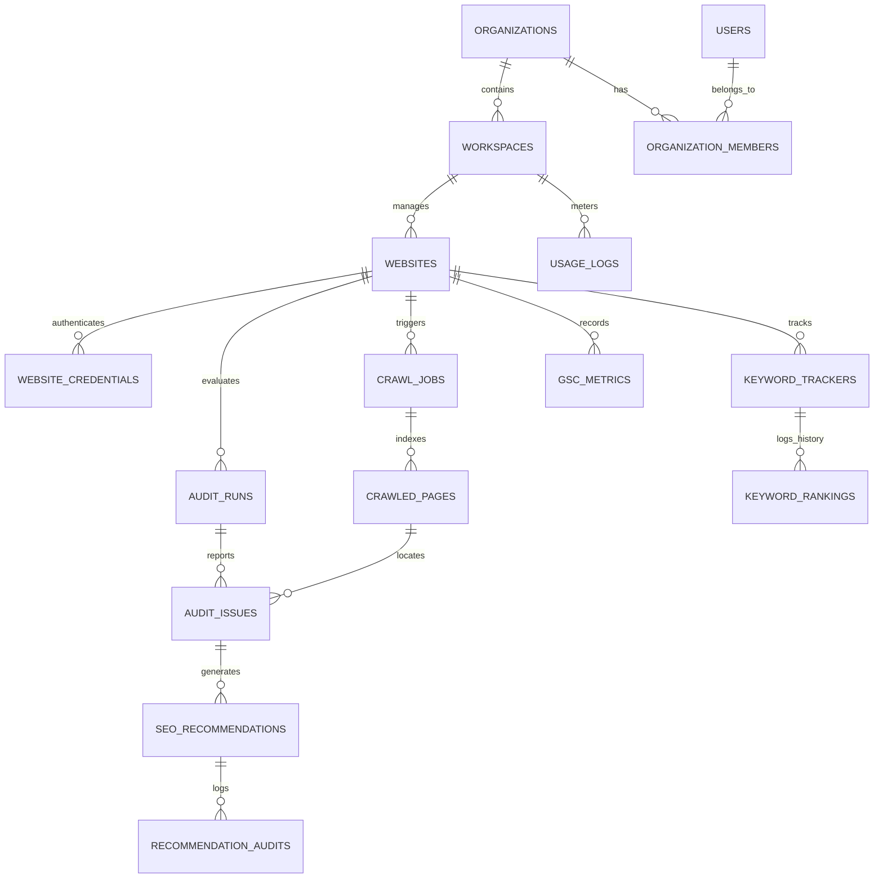

# DATABASE DESIGN & SCHEMA SPECIFICATION
**Project:** Web SEO AI  
**Target Engine:** PostgreSQL 16+ (with SQLite compatibility for local unit testing)  
**Version:** 1.0.0 (Phase 0 Baseline)  

---

## 1. Entity-Relationship Overview

---

## 2. Table Schemas & Column Specifications

### 2.1 Identity, Tenancy & Access Control

#### `users`
Core user identity for agency personnel and client viewers.
| Column | Type | Constraints | Description |
| :--- | :--- | :--- | :--- |
| `id` | `uuid` | PRIMARY KEY, default `gen_random_uuid()` | Unique user identifier |
| `name` | `varchar(255)` | NOT NULL | Full name |
| `email` | `varchar(255)` | NOT NULL, UNIQUE | User email address |
| `password` | `varchar(255)` | NOT NULL | Bcrypt/Argon2id hashed password |
| `is_super_admin` | `boolean` | DEFAULT false | Global platform superadmin flag |
| `email_verified_at`| `timestamp with time zone` | NULLABLE | Verification timestamp |
| `remember_token` | `varchar(100)` | NULLABLE | Session remember token |
| `created_at` | `timestamp with time zone` | NOT NULL, default `now()` | Record creation timestamp |
| `updated_at` | `timestamp with time zone` | NOT NULL, default `now()` | Record update timestamp |

#### `organizations`
Top-level multi-tenant account container (e.g., "Techboloy Agency" or external SaaS company).
| Column | Type | Constraints | Description |
| :--- | :--- | :--- | :--- |
| `id` | `uuid` | PRIMARY KEY | Unique organization ID |
| `name` | `varchar(255)` | NOT NULL | Organization name |
| `slug` | `varchar(255)` | NOT NULL, UNIQUE | URL-friendly unique identifier |
| `billing_plan` | `varchar(50)` | DEFAULT 'agency_internal' | Current plan (`internal`, `starter`, `agency_pro`, `enterprise`) |
| `created_at` | `timestamp with time zone` | NOT NULL | Creation timestamp |
| `updated_at` | `timestamp with time zone` | NOT NULL | Update timestamp |

#### `organization_members`
User membership and role assignments within organizations.
| Column | Type | Constraints | Description |
| :--- | :--- | :--- | :--- |
| `id` | `uuid` | PRIMARY KEY | Membership record ID |
| `organization_id` | `uuid` | NOT NULL, FK -> `organizations(id)` ON DELETE CASCADE | Scoped organization |
| `user_id` | `uuid` | NOT NULL, FK -> `users(id)` ON DELETE CASCADE | User reference |
| `role` | `varchar(50)` | NOT NULL | `org_admin`, `seo_manager`, `seo_specialist`, `client_viewer` |
| `created_at` | `timestamp with time zone` | NOT NULL | Membership creation date |
| *Index* | `UNIQUE(organization_id, user_id)` | | Prevents duplicate memberships |

#### `workspaces`
Sub-units within an organization to isolate specific clients, projects, or brands.
| Column | Type | Constraints | Description |
| :--- | :--- | :--- | :--- |
| `id` | `uuid` | PRIMARY KEY | Unique workspace ID |
| `organization_id` | `uuid` | NOT NULL, FK -> `organizations(id)` ON DELETE CASCADE | Parent organization |
| `name` | `varchar(255)` | NOT NULL | Workspace name (e.g. "Client: CareMate BD") |
| `slug` | `varchar(255)` | NOT NULL | URL slug unique within org |
| `settings` | `jsonb` | DEFAULT '{}' | Custom audit thresholds, notification webhooks |
| `created_at` | `timestamp with time zone` | NOT NULL | Creation date |
| `updated_at` | `timestamp with time zone` | NOT NULL | Update date |
| *Index* | `UNIQUE(organization_id, slug)` | | Slug uniqueness per org |

---

### 2.2 Website Registry & CMS Integrations

#### `websites`
Target websites registered for auditing, crawling, and SEO management.
| Column | Type | Constraints | Description |
| :--- | :--- | :--- | :--- |
| `id` | `uuid` | PRIMARY KEY | Unique website ID |
| `workspace_id` | `uuid` | NOT NULL, FK -> `workspaces(id)` ON DELETE CASCADE | Scoped workspace |
| `domain` | `varchar(255)` | NOT NULL | Primary hostname (e.g., `example.com`) |
| `target_url` | `varchar(1024)` | NOT NULL | Full root URL (e.g., `https://example.com`) |
| `cms_type` | `varchar(50)` | NOT NULL, DEFAULT 'custom' | `wordpress`, `shopify`, `custom` |
| `sitemap_url` | `varchar(1024)` | NULLABLE | Discovered or configured sitemap.xml |
| `is_verified` | `boolean` | DEFAULT false | Domain ownership verification flag |
| `verification_method` | `varchar(50)` | NULLABLE | `dns_txt`, `html_meta`, `file_upload` |
| `health_score` | `smallint` | DEFAULT 0 | Aggregate SEO health score (0-100) |
| `created_at` | `timestamp with time zone` | NOT NULL | Creation date |
| `updated_at` | `timestamp with time zone` | NOT NULL | Update date |
| *Index* | `UNIQUE(workspace_id, domain)` | | Domain uniqueness per workspace |

#### `website_credentials`
Secure storage for CMS and API connection credentials.
| Column | Type | Constraints | Description |
| :--- | :--- | :--- | :--- |
| `id` | `uuid` | PRIMARY KEY | Unique credential ID |
| `website_id` | `uuid` | NOT NULL, FK -> `websites(id)` ON DELETE CASCADE | Target website |
| `provider` | `varchar(50)` | NOT NULL | `wordpress_rest`, `shopify_graphql`, `gsc_oauth` |
| `encrypted_payload`| `text` | NOT NULL | Encrypted API keys, app passwords, or refresh tokens |
| `status` | `varchar(50)` | DEFAULT 'active' | `active`, `expired`, `revoked`, `error` |
| `last_verified_at` | `timestamp with time zone` | NULLABLE | Timestamp of last successful handshake |
| `created_at` | `timestamp with time zone` | NOT NULL | Creation date |
| `updated_at` | `timestamp with time zone` | NOT NULL | Update date |
| *Index* | `UNIQUE(website_id, provider)` | | One active credential set per provider |

---

### 2.3 Crawler & Technical Audit Engine

#### `crawl_jobs`
Lifecycle tracking for website crawl operations.
| Column | Type | Constraints | Description |
| :--- | :--- | :--- | :--- |
| `id` | `uuid` | PRIMARY KEY | Unique crawl run ID |
| `website_id` | `uuid` | NOT NULL, FK -> `websites(id)` ON DELETE CASCADE | Target website |
| `initiated_by` | `uuid` | NULLABLE, FK -> `users(id)` ON DELETE SET NULL | Triggering user or NULL for cron |
| `status` | `varchar(50)` | NOT NULL, DEFAULT 'queued' | `queued`, `crawling`, `completed`, `failed`, `cancelled` |
| `max_pages` | `integer` | DEFAULT 250 | Hard page limit for the crawl run |
| `pages_discovered`| `integer` | DEFAULT 0 | Count of URLs discovered in sitemap/links |
| `pages_crawled` | `integer` | DEFAULT 0 | Count of URLs successfully fetched |
| `started_at` | `timestamp with time zone` | NULLABLE | Execution start timestamp |
| `finished_at` | `timestamp with time zone` | NULLABLE | Execution finish timestamp |
| `error_message` | `text` | NULLABLE | Fatal failure reason if failed |

#### `crawled_pages`
Detailed snapshot of individual URLs analyzed during a crawl.
| Column | Type | Constraints | Description |
| :--- | :--- | :--- | :--- |
| `id` | `uuid` | PRIMARY KEY | Unique page ID |
| `crawl_job_id` | `uuid` | NOT NULL, FK -> `crawl_jobs(id)` ON DELETE CASCADE | Associated crawl run |
| `website_id` | `uuid` | NOT NULL, FK -> `websites(id)` ON DELETE CASCADE | Scoped website |
| `url` | `text` | NOT NULL | Full page URL |
| `url_hash` | `char(64)` | NOT NULL | SHA-256 hash of normalized URL for fast lookups |
| `status_code` | `smallint` | NOT NULL | HTTP status code (200, 301, 404, 500, etc.) |
| `load_time_ms` | `integer` | NULLABLE | Total page fetch time in milliseconds |
| `page_title` | `varchar(1024)` | NULLABLE | Extracted `<title>` tag |
| `meta_description`| `text` | NULLABLE | Extracted `<meta name="description">` |
| `canonical_url` | `text` | NULLABLE | Extracted `rel="canonical"` URL |
| `h1_tags` | `jsonb` | DEFAULT '[]' | Array of extracted H1 text strings |
| `word_count` | `integer` | DEFAULT 0 | Estimated body text word count |
| `is_indexable` | `boolean` | DEFAULT true | False if noindex header or meta tag present |
| `snapshot_storage_path` | `varchar(1024)` | NULLABLE | Object storage key for compressed raw DOM HTML |
| `created_at` | `timestamp with time zone` | NOT NULL | Page record timestamp |
| *Index* | `INDEX(crawl_job_id, url_hash)` | | Fast page lookup |

#### `audit_runs`
Evaluated technical audit snapshots.
| Column | Type | Constraints | Description |
| :--- | :--- | :--- | :--- |
| `id` | `uuid` | PRIMARY KEY | Unique audit run ID |
| `website_id` | `uuid` | NOT NULL, FK -> `websites(id)` ON DELETE CASCADE | Scoped website |
| `crawl_job_id` | `uuid` | NOT NULL, FK -> `crawl_jobs(id)` ON DELETE CASCADE | Source crawl data |
| `technical_score` | `smallint` | DEFAULT 0 | Technical SEO score (0-100) |
| `content_score` | `smallint` | DEFAULT 0 | On-Page content score (0-100) |
| `performance_score` | `smallint` | DEFAULT 0 | Speed / Core Web Vitals score (0-100) |
| `overall_score` | `smallint` | DEFAULT 0 | Weighted overall score (0-100) |
| `critical_issues_count` | `integer` | DEFAULT 0 | Count of critical priority issues |
| `warning_issues_count` | `integer` | DEFAULT 0 | Count of warning priority issues |
| `info_issues_count` | `integer` | DEFAULT 0 | Count of informational opportunities |
| `created_at` | `timestamp with time zone` | NOT NULL | Audit run completion timestamp |

#### `audit_issues`
Discrete violations or optimization opportunities identified by rules.
| Column | Type | Constraints | Description |
| :--- | :--- | :--- | :--- |
| `id` | `uuid` | PRIMARY KEY | Unique issue ID |
| `audit_run_id` | `uuid` | NOT NULL, FK -> `audit_runs(id)` ON DELETE CASCADE | Associated audit run |
| `crawled_page_id`| `uuid` | NULLABLE, FK -> `crawled_pages(id)` ON DELETE CASCADE | Specific page affected |
| `category` | `varchar(50)` | NOT NULL | `technical`, `on_page`, `performance`, `security`, `schema` |
| `severity` | `varchar(20)` | NOT NULL | `critical`, `warning`, `info` |
| `rule_code` | `varchar(100)` | NOT NULL | e.g. `MISSING_TITLE`, `DUPLICATE_H1`, `BROKEN_INTERNAL_LINK` |
| `title` | `varchar(255)` | NOT NULL | Human-readable issue summary |
| `description` | `text` | NOT NULL | Detailed explanation of SEO risk |
| `recommendation`| `text` | NOT NULL | Standard remediation instruction |
| `context_data` | `jsonb` | DEFAULT '{}' | Selector, element HTML snippet, response headers |
| `created_at` | `timestamp with time zone` | NOT NULL | Creation timestamp |

---

### 2.4 AI Optimization & Approval State Machine

#### `seo_recommendations`
AI-generated remediation items awaiting human approval or scheduled deployment.
| Column | Type | Constraints | Description |
| :--- | :--- | :--- | :--- |
| `id` | `uuid` | PRIMARY KEY | Unique recommendation ID |
| `website_id` | `uuid` | NOT NULL, FK -> `websites(id)` ON DELETE CASCADE | Target website |
| `audit_issue_id` | `uuid` | NULLABLE, FK -> `audit_issues(id)` ON DELETE SET NULL | Originating audit issue |
| `page_url` | `text` | NOT NULL | Target URL for the fix |
| `field_target` | `varchar(100)` | NOT NULL | `title_tag`, `meta_description`, `schema_jsonld`, `h1` |
| `current_value` | `text` | NULLABLE | Existing live value |
| `proposed_value`| `text` | NOT NULL | AI-generated optimized value |
| `ai_provider` | `varchar(50)` | NOT NULL | `gemini-1.5-pro`, `gpt-4o`, `claude-3-5-sonnet` |
| `tokens_consumed`| `integer` | DEFAULT 0 | Total prompt + completion tokens |
| `status` | `varchar(50)` | NOT NULL, DEFAULT 'pending_review' | `pending_review`, `approved`, `rejected`, `executing`, `applied`, `failed`, `rolled_back` |
| `approved_by` | `uuid` | NULLABLE, FK -> `users(id)` ON DELETE SET NULL | Approving user ID |
| `approved_at` | `timestamp with time zone` | NULLABLE | Approval timestamp |
| `applied_at` | `timestamp with time zone` | NULLABLE | Execution timestamp |
| `rollback_snapshot`| `jsonb` | NULLABLE | Pre-mutation CMS state for safe rollback |
| `execution_error`| `text` | NULLABLE | CMS API error description if execution failed |
| `created_at` | `timestamp with time zone` | NOT NULL | Creation timestamp |
| `updated_at` | `timestamp with time zone` | NOT NULL | Update timestamp |

#### `recommendation_audits`
Immutable historical log of all review actions and automated executions.
| Column | Type | Constraints | Description |
| :--- | :--- | :--- | :--- |
| `id` | `uuid` | PRIMARY KEY | Unique audit log ID |
| `recommendation_id`| `uuid` | NOT NULL, FK -> `seo_recommendations(id)` ON DELETE CASCADE | Associated recommendation |
| `user_id` | `uuid` | NULLABLE, FK -> `users(id)` ON DELETE SET NULL | Acting user or NULL for worker |
| `action` | `varchar(50)` | NOT NULL | `approved`, `rejected`, `edited`, `executed`, `rolled_back` |
| `previous_state` | `varchar(50)` | NOT NULL | State before transition |
| `new_state` | `varchar(50)` | NOT NULL | State after transition |
| `comment` | `text` | NULLABLE | Optional reviewer feedback or note |
| `created_at` | `timestamp with time zone` | NOT NULL, default `now()` | Log timestamp |

---

### 2.5 Search Console, Keywords & Analytics

#### `keyword_trackers`
Target search queries actively monitored for rank changes.
| Column | Type | Constraints | Description |
| :--- | :--- | :--- | :--- |
| `id` | `uuid` | PRIMARY KEY | Unique keyword ID |
| `website_id` | `uuid` | NOT NULL, FK -> `websites(id)` ON DELETE CASCADE | Scoped website |
| `keyword` | `varchar(255)` | NOT NULL | Search term |
| `target_url` | `varchar(1024)` | NULLABLE | Intended target landing page |
| `country` | `char(2)` | DEFAULT 'US' | Target country code |
| `current_position`| `decimal(5,2)` | NULLABLE | Most recent recorded rank |
| `best_position` | `decimal(5,2)` | NULLABLE | Highest recorded rank |
| `monthly_search_volume`| `integer` | NULLABLE | Estimated search volume |
| `created_at` | `timestamp with time zone` | NOT NULL | Tracking start date |
| *Index* | `UNIQUE(website_id, keyword, country)`| | No duplicate keyword tracking per geo |

#### `keyword_rankings`
Daily time-series ranking history.
| Column | Type | Constraints | Description |
| :--- | :--- | :--- | :--- |
| `id` | `bigserial` | PRIMARY KEY | Time-series record ID |
| `keyword_tracker_id`| `uuid` | NOT NULL, FK -> `keyword_trackers(id)` ON DELETE CASCADE | Scoped keyword |
| `date` | `date` | NOT NULL | Performance observation date |
| `position` | `decimal(5,2)` | NOT NULL | Recorded average position |
| `impressions` | `integer` | DEFAULT 0 | GSC impressions |
| `clicks` | `integer` | DEFAULT 0 | GSC clicks |
| *Index* | `UNIQUE(keyword_tracker_id, date)` | | One entry per keyword per day |

---

### 2.6 Usage Metering & Future SaaS Billing

#### `usage_logs`
Fine-grained consumption tracking for quota enforcement and client invoicing.
| Column | Type | Constraints | Description |
| :--- | :--- | :--- | :--- |
| `id` | `bigserial` | PRIMARY KEY | Unique log ID |
| `workspace_id` | `uuid` | NOT NULL, FK -> `workspaces(id)` ON DELETE CASCADE | Attributed workspace |
| `metric_type` | `varchar(50)` | NOT NULL | `pages_crawled`, `ai_tokens`, `audit_runs`, `recommendations_applied` |
| `quantity` | `integer` | NOT NULL | Units consumed |
| `metadata` | `jsonb` | DEFAULT '{}' | Reference to specific `crawl_job_id` or `ai_recommendation_id` |
| `recorded_at` | `timestamp with time zone` | NOT NULL, default `now()` | Consumption timestamp |
| *Index* | `INDEX(workspace_id, metric_type, recorded_at)` | | Aggregated quota checks |

---

## 3. Migration Safety & Evolution Rules

1. **UUID Primary Keys:** All customer-facing entities use UUIDs to guarantee cross-tenant privacy, eliminate sequential ID scraping, and enable seamless multi-region sharding in the future.
2. **Strict Foreign Keys:** All child relations enforce explicit `ON DELETE CASCADE` or `ON DELETE SET NULL`. Orphaned database rows are strictly prohibited.
3. **No Destructive Drops:** Column renames or drops must follow a two-step release lifecycle (deprecate -> drop in subsequent version) with zero data loss.
4. **JSONB For Unbounded Payloads:** Dynamic audit metadata, schema contexts, and DOM extraction trees are housed in indexed `jsonb` columns, preserving high relational performance for indexed fields.
