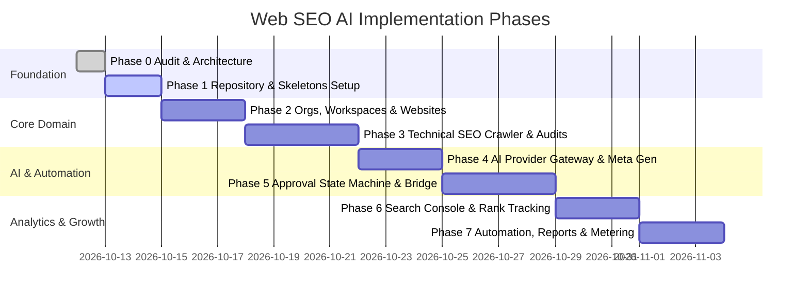

# IMPLEMENTATION ROADMAP & PHASE GATES
**Project:** Web SEO AI  
**Version:** 1.0.0 (Phase 0 Baseline)  
**Execution Model:** Phased Milestone Delivery with Strict Quality Gates  

---

## 1. Roadmap Overview & Timeline

---

## 2. Phase Breakdown & Deliverables

### Phase 0: Project Audit and Foundation (COMPLETED)
- **Goal:** Audit workspace, verify runtimes, eliminate assumptions, formalize architecture, schema, security rules, and baseline contracts.
- **Key Deliverables:**
  - `PROJECT_AUDIT.md`
  - `ARCHITECTURE.md`
  - `DATABASE_DESIGN.md`
  - `SECURITY_REQUIREMENTS.md`
  - `IMPLEMENTATION_ROADMAP.md`
  - `.env.example`
- **Exit Gate:** All Phase 0 architectural requirements satisfied; greenfield status confirmed.

---

### Phase 1: Repository Setup & Skeleton Initialization
- **Goal:** Initialize isolated `backend/` (Laravel 11) and `frontend/` (Next.js 15) applications, configure testing frameworks, and set up database connection.
- **Backend Tasks:**
  - Initialize Laravel 11 application with PHP 8.4 in `backend/`.
  - Configure Laravel Sanctum for API authentication.
  - Implement base REST API response envelope trait and exception handler.
  - Set up PostgreSQL database connection with SQLite fallback for local test suite.
  - Run initial migrations (users, personal access tokens).
- **Frontend Tasks:**
  - Initialize Next.js 15 App Router app with TypeScript, Tailwind CSS, and Lucide icons in `frontend/`.
  - Establish API client with base URL configuration and authentication token headers.
  - Implement authentication screens (Login, Forgot Password).
- **Quality Gate:** Backend and frontend boot successfully; health check endpoint `/api/v1/health` returns HTTP 200 with database status; automated test passes.

---

### Phase 2: Core Platform, Organizations & Website Registry
- **Goal:** Implement multi-tenant organizational structure, client workspaces, and website registry with encrypted credentials.
- **Tasks:**
  - Database migrations for `organizations`, `organization_members`, `workspaces`, `websites`, `website_credentials`.
  - Domain models, tenant query scopes, and RBAC authorization policies.
  - API endpoints for listing, creating, and editing websites and workspaces.
  - Encryption service for WordPress Application Passwords and Shopify tokens.
  - Next.js dashboard UI: Workspace switcher, website directory table, add website modal with CMS type selector.
- **Quality Gate:** Users can create an organization, create client workspaces, add websites, and save encrypted credentials without plaintext exposure.

---

### Phase 3: Technical SEO Crawler & Audit Rules Engine
- **Goal:** Build asynchronous crawler, headless DOM extraction, and automated SEO issue evaluation.
- **Tasks:**
  - Crawler module with SSRF defense (IP blacklist, protocol filter, loopback block).
  - Background queued jobs: `InitiateCrawlJob` and `AnalyzePageJob`.
  - Audit rules evaluator:
    - *Technical:* Status codes (3xx/4xx/5xx), canonical consistency, robots.txt conformance, sitemap validation.
    - *On-Page:* Title length (40-60 chars), meta description presence/length, H1 tag hierarchy, image alt tags, word count.
    - *Schema:* JSON-LD syntax and required schema type validation.
  - Aggregated health score calculation (0-100).
  - Next.js Audit UI: Health score gauges, category issue breakdown, affected URLs table, and issue detail drawer.
- **Quality Gate:** Automated crawl executes against a test domain; issues correctly categorized and saved to PostgreSQL; no SSRF vulnerabilities.

---

### Phase 4: AI Provider Abstraction & Content Optimization Engine
- **Goal:** Build the unified LLM gateway and automated SEO content optimizer.
- **Tasks:**
  - Multi-driver `AiManager` supporting Google Gemini (Flash/Pro) and OpenAI (GPT-4o).
  - System prompt template system with context variable injection.
  - Structured output schema enforcement for deterministic JSON responses.
  - AI generation endpoints for:
    - Title tag generation & optimization.
    - Meta description copywriting.
    - Structured Schema.org JSON-LD generation (FAQ, Article, LocalBusiness, Breadcrumb).
  - Frontend optimization workbench: Side-by-side comparison of current vs proposed values with character counters and live Google SERP preview.
- **Quality Gate:** AI engine returns valid JSON conforming to output schemas; tokens tracked; zero prompt injection leakage.

---

### Phase 5: Recommendation Engine & Approval-Based Execution Workflow
- **Goal:** Build the human-in-the-loop review board, WordPress/Shopify execution bridge, and rollback snapshots.
- **Tasks:**
  - State machine for `seo_recommendations` (`pending_review` -> `approved` / `rejected` -> `executing` -> `applied` / `rolled_back`).
  - Pre-execution snapshot capture in `rollback_snapshot` column.
  - Execution drivers:
    - `WordPressDriver`: Updates post/page meta via WP REST API using Application Passwords.
    - `ShopifyDriver`: Updates product/article meta via Shopify GraphQL API.
  - Verification crawler: Re-crawls the modified URL post-execution to confirm the live page reflects the updated values.
  - One-click rollback endpoint.
  - Next.js Approvals Board: Diff viewer, batch review actions, execution progress indicators.
- **Quality Gate:** Changes can be proposed, reviewed, approved, and executed to a test CMS endpoint with a complete audit trail; rollback successfully restores original values.

---

### Phase 6: Google Search Console Analytics & Monitoring
- **Goal:** Integrate Google Search Console for organic traffic, impressions, and keyword rank correlation.
- **Tasks:**
  - GSC OAuth2 handshake and encrypted token storage.
  - Daily synchronization job for clicks, impressions, CTR, and average position.
  - Keyword tracker module and time-series ranking history.
  - Next.js Analytics dashboard: Organic performance line charts, keyword position table, and impact attribution (correlating applied recommendations with ranking changes).
- **Quality Gate:** GSC data ingested into PostgreSQL; rank changes visualized without UI lag.

---

### Phase 7: Automation, Scheduled Audits, Agency White-Label Reports & Metering
- **Goal:** Complete automated recurring tasks, white-label client PDF reporting, and usage metering for future SaaS subscriptions.
- **Tasks:**
  - Recurring scheduled jobs via Laravel Scheduler: Weekly audit runs, monthly client executive summaries.
  - PDF report generator (white-labeled with agency logo, client branding, and health score changes).
  - Usage metering engine tracking audit runs, crawled pages, and AI tokens.
  - Multi-tenant quota enforcement and subscription tier scaffolding.
- **Quality Gate:** End-to-end platform supports multi-workspace operations with zero manual database interventions.
