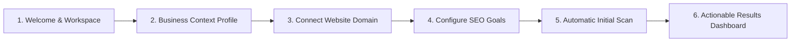
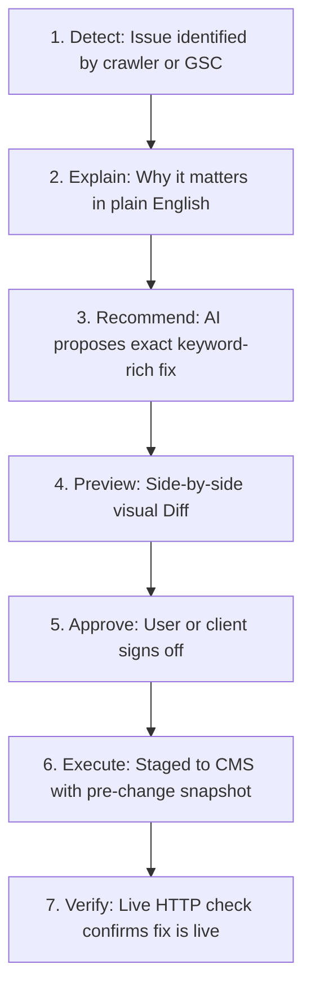

# WEB SEO AI — PROPOSED USER JOURNEY & INFORMATION ARCHITECTURE

**Date:** October 13, 2026  
**Product Vision:** An intuitive, beginner-friendly, professional AI SEO platform designed for non-technical business owners and agency SEO managers alike.

---

## 1. The Redesigned Onboarding Workflow



### Stage 1: Welcome & Quick Profile
- Friendly welcome screen: *"Welcome to Web SEO AI. Let's get your website discovered on Google."*
- Organization name and optional business niche / target audience. (Skippable with one click: *"I'll fill this in later"*).

### Stage 2: Connect Website (Clean Separation of Scanning vs Writing)
- User inputs **Website URL** (e.g. `https://mybusiness.com`).
- The system automatically extracts domain name and normalizes protocols.
- **Clear Capability Boundary**:
  - **Phase 1 (Instant):** Read-only SEO Health Scan — No passwords or server changes needed. Starts immediately.
  - **Phase 2 (Optional):** Google Search Console connection for real traffic analytics.
  - **Phase 3 (When ready to publish fixes):** CMS write integration (WordPress Application Password or Shopify OAuth).

### Stage 3: Initial Scan & Instant Aha-Moment!
- The scan runs with a real-time progress bar:
  `Discovering pages → Checking meta tags → Analyzing site speed → Identifying quick wins`.
- Results are displayed immediately upon completion with an **Executive Health Score (0-100)** and top 3 critical fixes.

---

## 2. Redesigned Navigation Structure

The sidebar is reduced from 12 confusing items to **9 intuitive, task-focused sections**:

```
Web SEO AI
├── 1. Overview (Dashboard & Your Next Best Action)
├── 2. My Websites (Site portfolio & connection statuses)
├── 3. SEO Action Plan (Unified Detect → Review → Fix Hub)
├── 4. Site Audit (Deep crawler, issues breakdown, page inspection)
├── 5. Content Studio (AI drafts, meta generator, FAQ writer)
├── 6. Performance (Search Console metrics, opportunities & keywords)
├── 7. Autopilot (Automation recipes & scheduled jobs)
├── 8. Clients & Team (Agency client workspaces, sign-off links, team permissions)
└── 9. Settings (Agency white-label branding, billing quotas, security)
```

---

## 3. The Unified "SEO Action Plan" Experience

Rather than scattering recommendations across three screens, every finding flows through a single **Unified Action State Machine**:



### Visual Recommendation Card Anatomy
Every item in the **SEO Action Plan** contains:
1. **Affected URL & Element:** Clickable link with the exact HTML element (e.g. `https://mysite.com/pricing` • `<title>`).
2. **Plain English Explanation:** Why this hurts search rankings (e.g. *"Google displays titles in search results. Without a title, your click-through rate drops significantly"*).
3. **Proposed Fix Preview:** Visual diff showing the current state vs. the recommended state.
4. **Risk Indicator & Benefit:** Green `Low Risk` badge and `+15-20% CTR Estimate`.
5. **Action Controls:**
   - **For Read-Only Sites:** Copy to clipboard with manual instructions.
   - **For Connected CMS Sites:** 1-click **"Approve & Apply to Website"** (reserves snapshot, applies via API, and reads back live verification).

---

## 4. Main Executive Dashboard ("Overview")

The default landing page for any connected website:
1. **Website Status Header:** Active website selector, connection status badge, last scan date, quick "Scan Now" button.
2. **Personalized "Your Next Best Action" Card:**
   - Highlights the highest-impact, lowest-effort SEO fix waiting for the user (e.g. *"Fix 3 missing meta titles on high-traffic landing pages"*).
   - Clear primary CTA button: **"Review & Fix Now"** which jumps straight into the visual diff modal.
3. **Key Vital Metrics (Zero Mock Data):**
   - Overall Health Score (0-100)
   - Pages Crawled
   - Open Issues (Critical / Warning / Info)
   - Verified Fixes Completed
   - 30-Day Search Clicks & Impressions (when GSC is connected)
4. **Active Automation & Approvals Pill:**
   - Informs the user if any background autopilot jobs or client sign-off requests are awaiting action.
5. **Recent Activity Timeline:**
   - Shows what the system or team members accomplished recently.
