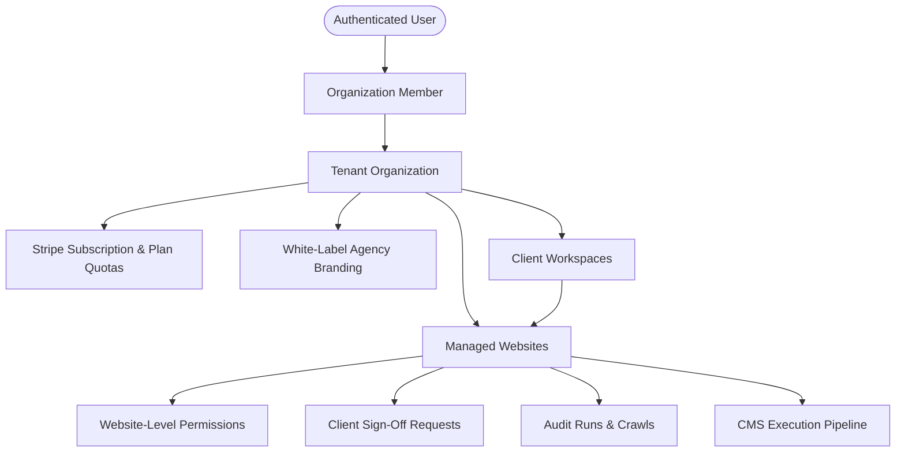

# PHASE 7 — Multi-Tenant Agency SaaS, Billing, and Launch Guide

## Executive Summary

Phase 7 prepares **Web SEO AI** for commercial SaaS operation and multi-client agency deployment. It introduces server-side quota tracking, Stripe-compatible subscription billing with idempotent webhook processing, agency client workspaces with external sign-off links, granular website-level ACLs, customizable white-label reports, and an ironclad tenant isolation boundary.

---

## 1. Multi-Tenant Organization & Client Architecture

Web SEO AI operates on a multi-tenant hierarchy designed for agencies managing multiple client accounts:

### Hierarchy & Scopes
1. **Organization (Agency Tenant)**: Root boundary of data isolation (`organizations` table). Holds the Stripe subscription, aggregate quotas, team members, audit logs, and branding.
2. **Client Workspaces (`client_workspaces`)**: Allows agencies to group client websites under a specific company/client profile (e.g. Acme Corp), manage dedicated points of contact, and issue approval sign-off requests.
3. **Website-Level Granular Permissions (`website_permissions`)**: While organization roles (`owner`, `admin`, `seo_manager`, `editor`, `viewer`) dictate baseline privileges, website-specific ACL overrides allow restricting external contractors, client reviewers, or junior staff to specific domains with granular flags:
   - `can_view`: Read audit reports and performance charts.
   - `can_edit`: Modify keywords, briefs, and recommendations.
   - `can_publish`: Initiate CMS publishing actions.
   - `can_approve`: Authorize staged CMS changes.

---

## 2. Subscription Plans & Quota Limits

All plan configurations are centralized in [`config/saas.php`](file:///Users/Alamin/Desktop/web-seo-ai/backend/config/saas.php). Quotas are verified **server-side** by [`QuotaEnforcementService.php`](file:///Users/Alamin/Desktop/web-seo-ai/backend/app/Domain/Billing/QuotaEnforcementService.php) at the API and background queue layers.

| Plan Feature | Starter ($49/mo) | Agency Pro ($199/mo) | Enterprise ($599/mo) | Techboloy Internal |
|---|---|---|---|---|
| **Websites Limit** | 3 active sites | 15 active sites | 100 active sites | Unlimited |
| **Max Pages per Crawl** | 250 pages | 5,000 pages | 50,000 pages | 100,000 pages |
| **Crawl Frequency** | Weekly | Daily | Hourly / Real-time | Unlimited |
| **Monthly AI Tokens** | 50,000 tokens | 500,000 tokens | 5,000,000 tokens | Unlimited |
| **Content Articles / Mo** | 10 articles | 100 articles | 1,000 articles | Unlimited |
| **Team Member Seats** | 2 seats | 10 seats | 50 seats | Unlimited |
| **CMS Live Execution** | ❌ (Read-only) | ✅ (WordPress & Shopify) | ✅ (Full + Webhooks) | ✅ |
| **White-Label Reports** | ❌ | ✅ (Logo, Theme, Name) | ✅ (Custom Domain) | ✅ |

### Server-Side Quota Enforcement Points
- **Websites Creation**: `QuotaEnforcementService::assertCanAddWebsite()` inside [`WebsiteController::store()`](file:///Users/Alamin/Desktop/web-seo-ai/backend/app/Http/Controllers/Api/V1/WebsiteController.php).
- **Crawl Size**: `assertCanCrawlPages()` inside [`CrawlController::startCrawl()`](file:///Users/Alamin/Desktop/web-seo-ai/backend/app/Http/Controllers/Api/V1/CrawlController.php).
- **Team Invitations**: `assertCanAddTeamMember()` inside [`OrganizationController::addMember()`](file:///Users/Alamin/Desktop/web-seo-ai/backend/app/Http/Controllers/Api/V1/OrganizationController.php).
- **Live CMS Writes**: `assertCanUseCmsWrite()` inside [`CmsExecutionController::execute()`](file:///Users/Alamin/Desktop/web-seo-ai/backend/app/Http/Controllers/Api/V1/CmsExecutionController.php).
- **White-Label Generation**: `assertCanExportWhiteLabel()` inside [`WhiteLabelReportController::getReport()`](file:///Users/Alamin/Desktop/web-seo-ai/backend/app/Http/Controllers/Api/V1/WhiteLabelReportController.php).

---

## 3. Stripe Billing & Webhook Processing

Implemented in [`BillingManager.php`](file:///Users/Alamin/Desktop/web-seo-ai/backend/app/Domain/Billing/BillingManager.php) and [`BillingController.php`](file:///Users/Alamin/Desktop/web-seo-ai/backend/app/Http/Controllers/Api/V1/BillingController.php).

### Zero Card Data Storage
Web SEO AI **never** stores raw card numbers, CVVs, or bank account details. All payment collection uses Stripe Checkout Sessions and Customer Portal redirection. Only tokenized customer references (`stripe_customer_id`, `stripe_subscription_id`), brand (`visa`), and last-4 digits (`4242`) are persisted.

### Webhook Verification & Strict Idempotency
Webhooks received at `POST /api/v1/billing/webhook` must pass HMAC-SHA256 signature verification against `STRIPE_WEBHOOK_SECRET`.

To guarantee idempotency during network retries:
1. Every event is logged in `billing_webhook_events` with unique `event_id`.
2. If `event_id` is already recorded with `status = 'processed'`, the request immediately terminates with HTTP 200 without executing side effects.
3. Supported events:
   - `checkout.session.completed`: Provisions active subscription and updates organization plan.
   - `invoice.paid`: Extends subscription period and resets monthly usage counters.
   - `invoice.payment_failed`: Transitions subscription to `past_due` and triggers alerts.
   - `customer.subscription.updated`: Applies plan upgrades or scheduled cancellations.
   - `customer.subscription.deleted`: Cancels subscription and downgrades organization to free/starter tier.

---

## 4. White-Label Agency Reports

Agencies on Agency Pro and Enterprise plans can customize client exports:
- **Branding Parameters**: Agency Brand Name, Logo URL, Theme Accent Color (hex code), Contact Email, and Custom Disclaimer Footer.
- **Badge Removal**: Optional suppression of "Web SEO AI" platform badges.
- **Fact vs. AI Separation**: Reports strictly distinguish between mechanically verified facts (HTTP response codes, canonical tags, real Google Search Console metrics) and AI-generated content suggestions.
- **Client Sign-off**: Client approval requests (`client_approval_requests`) generate expiring secure links (`/client-approval/{token}`) where clients can review strategies and record formal approval without needing full platform user accounts.

---

## 5. Security & Public SaaS Launch Criteria

### Strict Tenant Isolation Proofs
Automated tests in [`tests/Feature/MultiTenantSaaSAndBillingTest.php`](file:///Users/Alamin/Desktop/web-seo-ai/backend/tests/Feature/MultiTenantSaaSAndBillingTest.php) prove that:
- Users cannot access another organization's websites, audits, or reports by tampering with route parameters.
- Users cannot trigger crawls or CMS modifications on foreign domains.
- All database queries are scoped to `$organization->id`.

### Organization Deletion Workflow (GDPR Compliance)
Organization owners can execute an irreversible tenant deletion (`POST /api/v1/organizations/current/delete`) by submitting their exact organization name as confirmation. This initiates a cascading wipe of all websites, audit runs, issues, crawl caches, CMS credentials, and memberships.

### Launch Checklist
- [x] Public self-registration disabled by default (`SAAS_PUBLIC_REGISTRATION_ENABLED=false`).
- [x] Multi-tenant isolation verified by unit and feature tests.
- [x] Quota enforcement verified for all plan tiers.
- [x] Webhook signature verification and idempotency verified.
- [x] SSRF protections active for all crawling and webhook dispatching.
- [x] AES-256 encryption active for all third-party CMS and OAuth tokens.
- [x] 0 errors on production Next.js 16 build.
