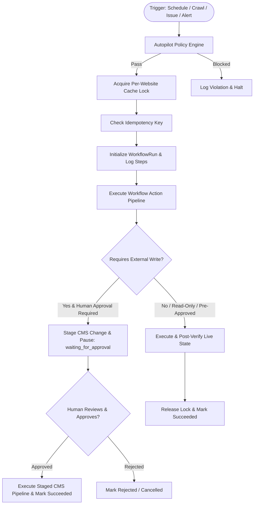

# PHASE 6 — SEO Autopilot and Workflow Automation

## Executive Summary

Phase 6 implements a durable, fault-tolerant background automation and policy engine for **Web SEO AI**. It empowers organizations to configure trigger-driven and scheduled automation rules that automate technical SEO audits, metadata draft synthesis, search console reporting, CMS publication, and error recoveries while maintaining an uncompromising security boundary: **AI may recommend actions, but cannot grant itself permission to execute external writes**.

---

## 1. Core Architecture Overview

The Autopilot Engine couples a stateful **Policy Engine**, a durable **Workflow Execution Service**, and a resilient **Step-Level Telemetry Logger** with per-website atomic locking and human-in-the-loop verification gates.

---

## 2. Automation Rules Management

Organizations manage automation rules scoped to specific websites. Rules can be configured, paused, resumed, or disabled at will.

### Supported Triggers
- `schedule`: Daily or weekly recurrence via background scheduler.
- `crawl_completion`: Automatically executed when a website crawl audit finishes.
- `new_issue_detected`: Fired when high-severity technical or metadata issues are flagged.
- `search_performance_threshold`: Triggered when Google Search Console metrics cross critical drops or opportunities.
- `content_ready_for_publishing`: Fired when an AI-generated draft article or metadata change is marked approved.
- `failed_action_recovery`: Recovery workflow triggered upon execution failure.

### Rule Policy Gates & Configuration
- `is_write_capable`: Boolean flag indicating if the rule performs mutating actions on the website or connected CMS. **Requires explicit opt-in.**
- `require_human_approval`: Enforces staging into the Approval Queue before any external CMS modification occurs.
- `dry_run_mode`: Simulates execution and step logs without making live network calls or staging real CMS mutations.
- `max_runs_per_day`: Daily rate-limiting cap (default: `10` runs/day).
- `monthly_cost_budget`: Financial safety cap (default: `$50.00`/month) preventing run-away token expenditures.

---

## 3. Workflow Execution Model & Supported Workflows

All workflow runs are persisted in the `workflow_runs` table with a unique identifier (`run_id`), organization and website scoping, retry tracking, token and cost rollups, and granular step telemetry.

### Run State Machine
- `queued`: Scheduled or triggered, awaiting worker pick-up.
- `running`: Actively executing steps under concurrency lock.
- `waiting_for_approval`: Write action staged; awaiting authorized human approval.
- `succeeded`: All steps completed and verified.
- `failed`: Terminated due to error (subject to bounded retry).
- `cancelled`: Manually cancelled by authorized user; revokes pending approvals.
- `partially_failed`: Multi-item workflow where non-critical steps encountered errors.

### The 5 Core Workflows

1. **Weekly Website Crawl & Issue Audit (`full_audit_and_recommend`)**:
   - Triggers a website crawl audit against verified domain.
   - Compares issues with previous crawl snapshots.
   - Generates AI recommendations and alerts assigned SEO managers.

2. **New Missing Metadata Synthesis (`generate_metadata_draft`)**:
   - Detects missing `<title>` or `<meta name="description">`.
   - Generates high-converting, keyword-optimized metadata draft via AI Content Strategist.
   - **Places draft into the human approval queue** (`waiting_for_approval`) and halts before external modification.

3. **Approved Content CMS Publication (`publish_approved_draft`)**:
   - Retrieves approved draft and verifies CMS connection.
   - Executes the 11-step `CmsExecutionPipeline` (pre-change snapshot, checksum verification, remote write).
   - Verifies the live change by reading back remote CMS state.
   - Emits structured audit trail logs.

4. **Search Performance Opportunities Sync (`search_performance_sync`)**:
   - Synchronizes latest Google Search Console impressions, clicks, CTR, and positions.
   - Analyzes striking-distance keywords and decaying queries.
   - Prepares an actionable executive opportunity report.

5. **Failed Action Recovery & Escalation (`recovery_and_escalate`)**:
   - Inspects failed execution context.
   - Executes bounded exponential backoff retries for transient errors.
   - Immediately alerts organization administrators if the issue is permanent or exceeds retry limits.

---

## 4. Policy Engine & Safety Guardrails

Implemented in [`app/Domain/Autopilot/AutopilotPolicyEngine.php`](file:///Users/Alamin/Desktop/web-seo-ai/backend/app/Domain/Autopilot/AutopilotPolicyEngine.php):

1. **Explicit Opt-In for Writes**:
   - Write-capable rules require `is_write_capable = true`.
   - Any write rule on read-only platforms (such as `custom` websites) is immediately rejected with an `AutomationPolicyViolationException`.

2. **No AI Self-Authorization**:
   - AI recommendations cannot self-approve CMS mutations. `require_human_approval` defaults to `true` for all write rules.

3. **Daily Frequency Limit**:
   - Daily run counter enforces `max_runs_per_day` per rule per website.

4. **Monthly Cost Budget Cap**:
   - Monthly token and operation costs are summed; execution is blocked if cumulative spend exceeds `monthly_cost_budget`.

5. **No Infinite Retries on Permanent Errors**:
   - HTTP 401 Unauthorized or HTTP 403 Forbidden credentials failures are recognized as permanent and immediately halted without retry.

---

## 5. Reliability & Concurrency Controls

- **Idempotency Keys**:
  - Each trigger generates or accepts an `idempotency_key` (e.g. `cron_20261012_site1_rule5`). Duplicate triggers within the idempotency window return the existing run immediately without re-executing.
- **Per-Website Concurrency Lock**:
  - Prevents race conditions and overlapping CMS writes using atomic `Cache::lock("workflow_automation_website_{$websiteId}", 60)`.
- **Cancellation & Approval Revocation**:
  - Cancelling an active or waiting workflow updates the run state to `cancelled` and immediately revokes all associated `workflow_approvals` and staged CMS requests.
- **Worker Recovery**:
  - Stalled jobs exceeding run deadlines can be identified via execution timestamps and marked failed or recovered cleanly.

---

## 6. Frontend User Interface

The Autopilot dashboard is accessible from the main navigation (`Autopilot Engine`) and provides:

1. **Automation Rules Builder**:
   - Interactive creation modal with trigger selection, action selection, write capability toggles, dry-run mode, and budget controls.
   - Pause, resume, and manual trigger controls.
2. **Interactive Run History & Step Telemetry**:
   - Real-time run timeline with live status badges (`running`, `waiting_for_approval`, `succeeded`, `failed`, `cancelled`).
   - Granular step-level drawer showing execution timing, input parameters, output data, and token cost details.
3. **Pending Approvals Queue**:
   - Dedicated review tab highlighting staged write requests with risk indicators, target URLs, and proposed changes.
   - 1-click **Approve & Execute** (resumes workflow pipeline) or **Reject** buttons.
4. **Dry-Run Indicator**:
   - Distinct badges and simulation tags showing that rules ran in simulation mode without mutating production data.

---

## 7. Acceptance Test Verification

Backend feature tests in [`tests/Feature/AutopilotAndWorkflowAutomationTest.php`](file:///Users/Alamin/Desktop/web-seo-ai/backend/tests/Feature/AutopilotAndWorkflowAutomationTest.php) verify all Phase 6 requirements:

| Test Case | Scope Verified |
|---|---|
| `can_create_pause_resume_and_disable_automation_rules` | Rule CRUD, pause, resume, and toggle states |
| `policy_engine_blocks_write_rules_on_read_only_custom_platforms` | Safety constraint blocking writes on read-only sites |
| `workflow_2_missing_metadata_places_item_in_approval_queue` | Missing metadata workflow staging into approval queue with `waiting_for_approval` |
| `human_approval_resumes_workflow_and_executes_cms_change` | User approval resuming workflow, triggering CMS pipeline, and completing run |
| `dry_run_mode_does_not_mutate_or_queue_live_changes` | Dry-run execution simulation without side effects |
| `workflow_cancellation_marks_run_and_revokes_pending_approvals` | Cancellation state mutation and approval revocation |
| `idempotency_prevents_duplicate_trigger_execution` | Idempotent key deduplication preventing duplicate execution |

Full backend test suite: **50 tests passing (302 assertions)**.
Frontend build: **100% clean Next.js 16 (Turbopack) production build**.
